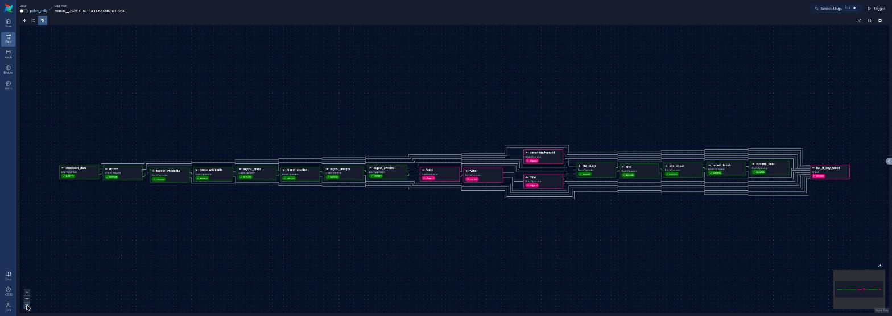
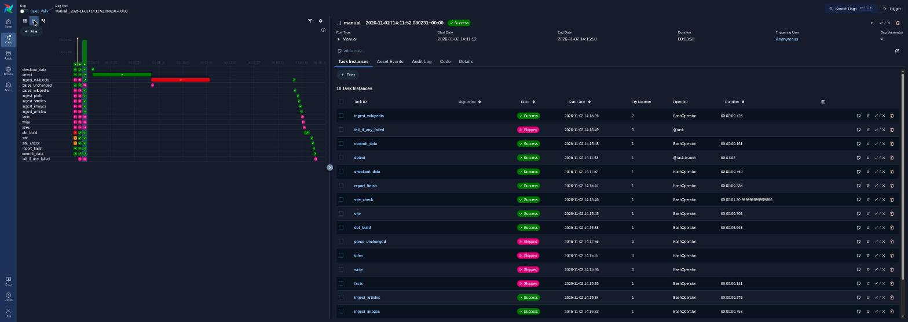
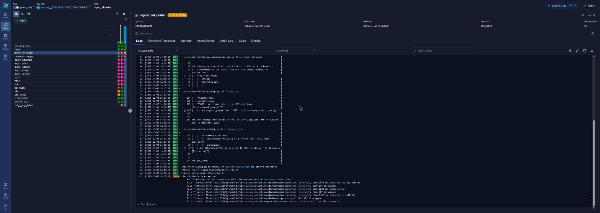

[English](README.md) · **Español**

# Paleo Atlas

Una enciclopedia paleontológica visual y viva, en español e inglés, que se reconstruye sola a partir de datos científicos abiertos.

**Web:** https://adaycuestacorrea.github.io/paleo-atlas/

**Estado:** la Fase 1 (especies de arcosaurios de 2026, en los dos idiomas) está publicada y GitHub Actions la actualiza a diario; la Fase 2 (Airflow) está en curso. El alcance completo está en [`ALCANCE.md`](ALCANCE.md).

Este README se completará en la Fase 4 (arquitectura, decisiones de diseño, benchmark, métricas).

## Airflow (local)

El mismo pipeline que GitHub Actions ejecuta cada día, como DAGs de Airflow 3.3 en Docker ([`airflow/`](airflow/)). Cada tarea llama a un comando `paleo`; los DAGs no tienen lógica propia del pipeline.

| DAG | Cuándo | Qué |
|---|---|---|
| `paleo_daily` | Mar–dom 06:23 UTC | Detección de cambios; el pipeline completo solo si cambió alguna fuente |
| `paleo_weekly` | Lun 06:23 UTC | Todo, sin detección de cambios (recap semanal) |
| `paleo_monthly` | Día 1 de cada mes | Todas las fuentes otra vez (retracciones, correcciones); GBIF y Spark llegan en la Fase 3 |
| `paleo_ci_parity` | Bajo demanda | El job de fixture del CI, para comparar su resultado con el del CI |

**Mismo resultado que GitHub Actions**, comprobado de tres formas: un test compara los comandos `paleo` de los DAGs con los de los workflows, en orden; `scripts/parity.py` compara una huella (un hash por tabla del almacén y por archivo de la web) del DAG `paleo_ci_parity` con la que sube el CI para el mismo commit; y el registro de una ejecución diaria del DAG coincide con el de la ejecución de Actions del mismo día. Los DAGs nunca publican: trabajan sobre un clon local de la rama `data` y solo Actions hace push.





```sh
cd airflow
./bin/init-work.sh                                  # clon local de la rama data
GIT_SHA=$(git rev-parse HEAD) docker compose up -d --build
# http://localhost:8080 (solo local, sin contraseña)
docker compose down
```

## Licencia

Código: [AGPL-3.0](LICENSE) · Contenido propio: [CC BY-NC-SA 4.0](LICENSE-CONTENT.md) · Los datos e imágenes de terceros mantienen su propia licencia.
