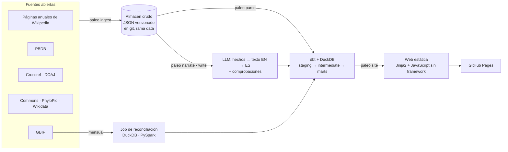

[English](README.md) · **Español**

# Paleo Atlas

Una enciclopedia paleontológica visual y viva, en español e inglés, que se reconstruye cada día a partir de datos científicos abiertos y sin coste.

**Web:** https://adaycuestacorrea.github.io/paleo-atlas/


## Qué es

- **4890 fichas** en dos idiomas (10 252 páginas web): los 4751 géneros de arcosaurios (dinosaurios, aves, pterosaurios, parientes de los cocodrilos), reptiles marinos y peces fósiles que recoge la Paleobiology Database, las 115 especies descritas en 2026 y 24 especies conocidas con estudios nuevos.
- **Se actualiza a diario** con fuentes abiertas: las páginas anuales de paleontología de Wikipedia, la Paleobiology Database (PBDB), Crossref, GBIF, Wikimedia Commons, PhyloPic, DOAJ y Wikidata.
- **Cada frase del texto cita su fuente** y pasa comprobaciones automáticas antes de publicarse: hechos y cifras contra la fuente, nombres científicos, nada copiado. Si una ficha no pasa alguna, muestra un texto construido con sus datos. Por ahora hay 397 fichas verificadas en inglés y 362 en español; el resto se redacta en lotes nocturnos con una GPU local.
- **Un historial por animal:** 19 541 eventos: 402 seguidos según ocurrían desde 2026 y 19 139 reconstruidos hacia atrás con las opiniones taxonómicas de PBDB y las páginas anuales de Wikipedia (2009–2025). Cada estudio lleva sus señales de fiabilidad (revisión por pares, preprint, retractación, revista de acceso abierto).
- **0 € al mes:** GitHub Actions, GitHub Pages, planes gratuitos de las API y un modelo local.

| | |
|---|---|
|  |  |
| **Explorador**: todas las fichas por periodo, grupo y país, con las cifras cruzadas. | **Ficha**: resumen rápido y su lugar en el tiempo geológico. |


*Las capturas incluyen imágenes de Wikimedia Commons; su autor y su licencia se ven en la propia imagen, y conservan su licencia.*

## Arquitectura



- **El estado vive en git.** Cada respuesta cruda se guarda como JSON versionado en la rama `data`, y el almacén (DuckDB) se reconstruye desde ahí en cada ejecución, así que cualquier día se puede reproducir. El historial (SCD tipo 2) sale en SQL de las versiones guardadas.
- **Comandos, no código del orquestador.** Cada paso es un comando `paleo`. GitHub Actions los ejecuta a diario, con una detección de cambios barata primero; los mismos comandos funcionan como DAGs de Airflow, con paridad demostrada.
- **Las fichas narrativas, como un pipeline.** Se extraen hechos con su fuente, se redacta un texto en inglés a partir de ellos, se adapta al español y se comprueba cada frase. Las especies nuevas usan el plan gratuito de Groq; los géneros de la enciclopedia, Qwen 3.5 9B en una GPU local, por lotes nocturnos.
- **Spark solo donde se ha medido.** La reconciliación de GBIF (932 494 especímenes fósiles) está hecha dos veces, en DuckDB y en PySpark, con el mismo resultado. Con este volumen DuckDB es entre 15 y 17 veces más rápido ([benchmark](benchmarks/gbif/results.md)), así que la capa diaria sigue en DuckDB.

## Tecnologías

Python 3.14 · uv · DuckDB · dbt · Jinja2 · JavaScript sin framework · GitHub Actions · GitHub Pages · Airflow 3.3 (Docker) · PySpark 4.2 · Ollama + Qwen 3.5 9B (local) · Groq (plan gratuito) · pytest · ruff

## Cifras

Medidas el 2026-11-07 en el almacén y en la suite de tests.

| | |
|---|---|
| Fichas (ES + EN) | 4890 taxones → 10 252 páginas web, comprobadas en cada build (enlaces rotos, versiones en el otro idioma, licencias) |
| Estudios | 8195, de ellos 586 comprobados en Crossref (retractaciones, correcciones, revisión por pares) |
| Registro fósil | 58 570 hallazgos de PBDB en 188 países · 138 388 especímenes de GBIF reconciliados con su género |
| Fichas narrativas | 397 verificadas en inglés y 362 en español (y crecen cada noche) |
| Tests | 216 de pytest · 132 de dbt en cada ejecución del pipeline (126 de datos y 6 unitarios) |
| Ejecución diaria | unos 4 minutos una ejecución completa con ingesta, más la publicación |
| Benchmark (932 494 filas) | DuckDB 0,86 s / 459 MB · Spark 13,7 s / 1,5 GB; 124 frente a 242 líneas de código |
| Coste | 0 € |

## Por qué no hay Spark en la capa diaria, y Spark frente a DuckDB medido

El pipeline diario trabaja con unos pocos miles de taxones y unas decenas de miles de filas por fuente: cabe en memoria de sobra, y arrancar una JVM costaría más que todo el trabajo. Por eso la capa diaria es DuckDB con dbt ([ADR D1](docs/adr/0001-sin-spark-en-la-capa-diaria.md)). Spark se usa donde un motor distribuido es al menos plausible, la reconciliación mensual de GBIF, y se **midió** contra DuckDB con las mismas 932 494 filas y el mismo resultado ([ADR D5](docs/adr/0005-spark-solo-para-gbif-y-medido.md)):

| Filas | DuckDB | Spark (local, 16 hilos) |
|---:|---:|---:|
| 93 004 | 0,48 s · 212 MB | 8,20 s · 1387 MB |
| 466 042 | 0,68 s · 286 MB | 10,20 s · 1735 MB |
| 932 494 | 0,86 s · 459 MB | 13,71 s · 1504 MB |

Unos 7,5 s del tiempo de Spark son coste fijo (JVM, sesión, planificación). Método y cifras completas: [`benchmarks/gbif/results.md`](benchmarks/gbif/results.md).

## Calidad de datos

- **Tests de dbt** en cada ejecución (126 de datos y 6 unitarios): claves, valores aceptados, relaciones, frescura de cada fuente y reglas de alcance; un error detiene la ejecución y los avisos quedan en el informe.
- **Informe de cada ejecución** (`paleo report`), guardado en la rama `data`: qué cambió, duraciones, recuentos.
- **Comprobación de la web** en cada build (`paleo site --check`): enlaces rotos, versión en el otro idioma, páginas a las que nadie enlaza, imágenes sin licencia.
- **Las fichas narrativas** solo se publican si cada frase pasa sus comprobaciones: hechos citados, mismas cifras, nombres científicos conservados, nada de copiar 8 o más palabras seguidas de una fuente; cómo funciona cada comprobación se explica en [`docs/fases/`](docs/fases/).
- **Los estudios** se comprueban en Crossref (retractaciones, correcciones, tipo) y en DOAJ, y se muestran con esas señales.

## Fuentes y licencias

| Fuente | Para qué | Licencia |
|---|---|---|
| Wikipedia (páginas anuales de paleontología, artículos de géneros) | Taxones y estudios nuevos; hechos para las fichas narrativas (cada hecho cita su revisión) | CC BY-SA 4.0 |
| Paleobiology Database | Catálogo, clasificación, edades, hallazgos, opiniones taxonómicas | CC BY 4.0 |
| GBIF | Especímenes fósiles en museos ([DOI 10.15468/dl.8v87yz](https://doi.org/10.15468/dl.8v87yz)) | La de cada conjunto de datos, citados con el DOI de la descarga |
| Crossref · DOAJ | Metadatos de los estudios, retractaciones, correcciones, revistas de acceso abierto | Metadatos abiertos |
| Wikimedia Commons · PhyloPic | Imágenes y siluetas, solo con licencias permitidas (sin NC) | Por archivo, visible en cada imagen |
| Wikidata | Comprobar qué artículo de Wikipedia corresponde a cada género | CC0 |
| Natural Earth | Mapas del mundo | Dominio público |

## Limitaciones conocidas

- **El parentesco sigue la clasificación de PBDB**, no un análisis filogenético; la posición de muchos animales está en debate, y las fichas lo dicen.
- **Las fichas narrativas cubren por ahora una minoría de los géneros** (397 en inglés y 362 en español, de 2743 géneros con artículo en Wikipedia). Con el modelo local, cerca de una cuarta parte de las adaptaciones al español no pasa las comprobaciones de copia y de cifras y no se publica; esa ficha muestra su texto construido con datos.
- **El idioma de cada estudio** viene de Crossref, que lo da en torno al 80 % de los estudios seguidos; el historial reconstruido hacia atrás (7600 estudios) no se comprueba en Crossref.
- **GitHub lanza la ejecución diaria tarde** (unas 8 horas la mayoría de los días), así que la actualización «diaria» suele llegar por la tarde (UTC).
- **Las especies nuevas tardan en llegar a PBDB**, así que muchas aún no tienen edades ni hallazgos; su periodo y su país salen de su descripción.

## Decisiones de diseño

Diez registros de decisiones de arquitectura, cada uno con su contexto, alternativas, consecuencias y pruebas ([`docs/adr/`](docs/adr/README.md)): sin Spark en la capa diaria · DuckDB en vez de una base de datos alojada · el estado en git y el almacén reconstruido · comandos independientes del orquestador · Spark solo para GBIF, y medido · solo licencias de imagen permitidas · fichas narrativas propias con hechos verificados · bilingüe desde el principio · historial SCD2 en SQL · detección de cambios barata.

Cómo funciona cada fase y por qué: [`docs/fases/`](docs/fases/). El alcance completo y su registro de cambios: [`ALCANCE.md`](ALCANCE.md).

## Ejecutarlo en local

```sh
uv sync
uv run paleo ingest wikipedia && uv run paleo parse wikipedia   # y pbdb, studies, images, articles
uv run paleo build                                              # dbt build (modelos + tests)
uv run paleo site && uv run paleo site --check                  # la web, en site/_build
cd site/_build && python3 -m http.server 8765                   # http://localhost:8765/es/
```

## Airflow (local)

El mismo pipeline que GitHub Actions ejecuta cada día, como DAGs de Airflow 3.3 en Docker ([`airflow/`](airflow/)). Cada tarea llama a un comando `paleo`; los DAGs no tienen lógica propia del pipeline.

| DAG | Cuándo | Qué |
|---|---|---|
| `paleo_daily` | Mar–dom 06:23 UTC | Detección de cambios; el pipeline completo solo si cambió alguna fuente |
| `paleo_weekly` | Lun 06:23 UTC | Todo, sin detección de cambios (recap semanal) |
| `paleo_monthly` | Día 1 de cada mes | Todas las fuentes otra vez (retracciones, correcciones), la descarga de GBIF y el job de Spark |
| `paleo_ci_parity` | Bajo demanda | El job de fixture del CI, para comparar su resultado con el del CI |

**Mismo resultado que GitHub Actions**, comprobado de tres formas: un test compara los comandos `paleo` de los DAGs con los de los workflows, en orden; `scripts/parity.py` compara una huella (un hash por tabla del almacén y por archivo de la web) del DAG `paleo_ci_parity` con la que sube el CI para el mismo commit; y el registro de una ejecución diaria del DAG coincide con el de la ejecución de Actions del mismo día. Los DAGs nunca publican: trabajan sobre un clon local de la rama `data` y solo Actions hace push.


```sh
cd airflow
./bin/init-work.sh                                  # clon local de la rama data
GIT_SHA=$(git rev-parse HEAD) docker compose up -d --build
# http://localhost:8080 (solo local, sin contraseña)
docker compose down
```

## Licencia

Código: [AGPL-3.0](LICENSE) · Contenido propio: [CC BY-NC-SA 4.0](LICENSE-CONTENT.md) · Los datos e imágenes de terceros mantienen su propia licencia.
