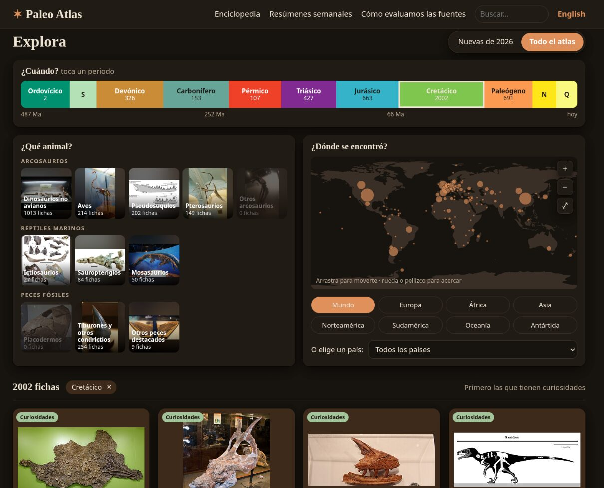
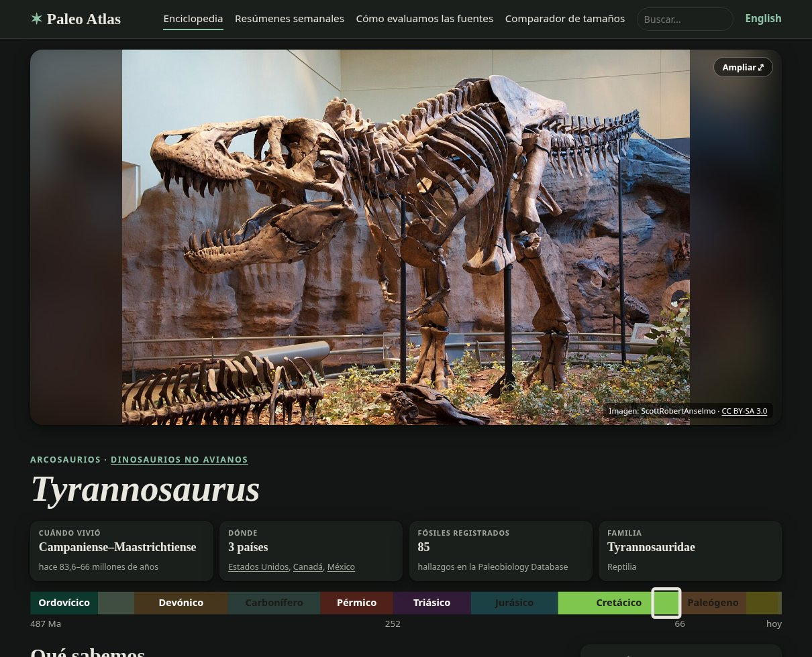
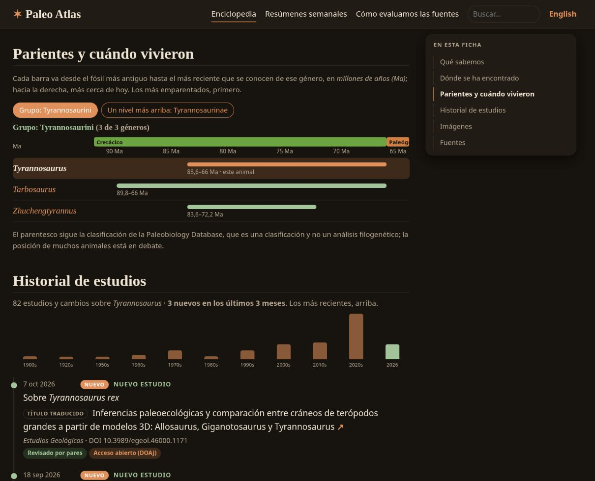
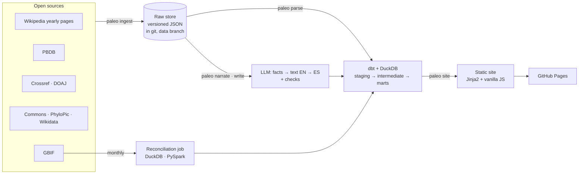
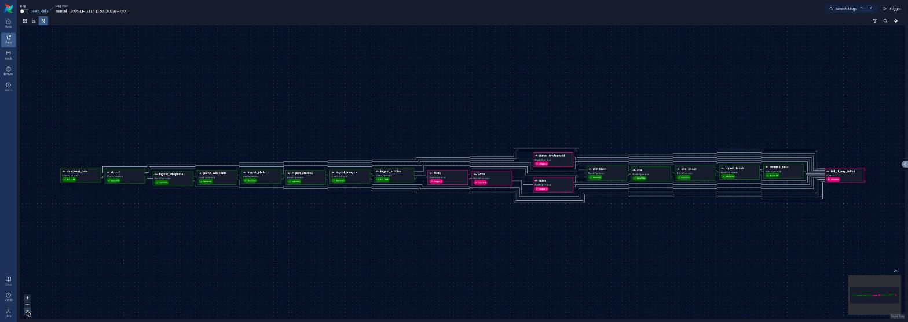
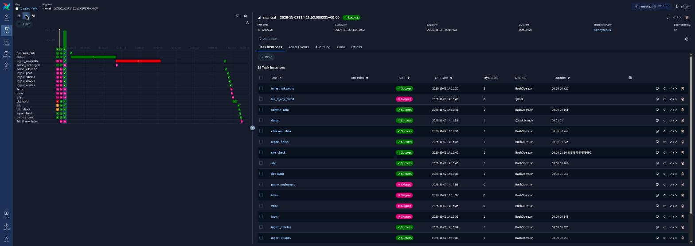
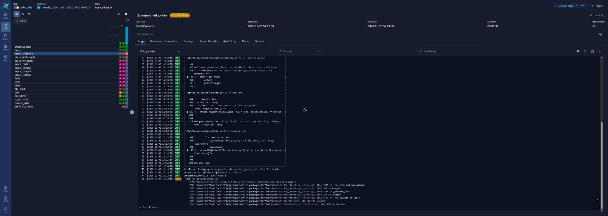

**English** · [Español](README.es.md)

# Paleo Atlas

A living, visual paleontology encyclopedia in Spanish and English, rebuilt every day from open scientific data, at no cost.

**Website:** https://adaycuestacorrea.github.io/paleo-atlas/


## What it is

- **4,890 pages** in two languages (10,260 web pages): the 4,751 genera of archosaurs (dinosaurs, birds, pterosaurs, crocodile relatives), marine reptiles and fossil fishes known to the Paleobiology Database, the 115 species described in 2026 and 24 known species with new studies.
- **Updated daily** from open sources: Wikipedia's yearly paleontology pages, the Paleobiology Database (PBDB), Crossref, GBIF, Wikimedia Commons, PhyloPic, DOAJ and Wikidata.
- **Every narrative sentence cites its source** and passes automatic checks before it is published: facts and numbers against the source, scientific names, no copied passages. A page that fails any check shows a text built from its data instead. So far 598 pages are verified in English and 582 in Spanish; the rest are written in nightly batches on a local GPU.
- **A history per animal:** 19,541 events: 402 tracked as they happened since 2026 and 19,139 rebuilt backwards from PBDB's taxonomic opinions and Wikipedia's yearly pages (2009–2025). Each study carries its reliability signals (peer review, preprint, retraction, open-access journal).
- **A size comparison:** a card on each page with a sourced size opens a window to put the animal next to people, living animals, buildings and other atlas animals, at scale, and drag the silhouettes over each other ([page](https://adaycuestacorrea.github.io/paleo-atlas/en/size.html)). Sizes come only from verified sentences: 429 taxa, read by a strict rule or, when doubtful, by an LLM whose numbers must be in the sentence.
- **0 € a month:** GitHub Actions, GitHub Pages, free API tiers and a local model.

| | |
|---|---|
|  |  |
| **Explorer**: every page by period, group and country, with cross counts. | **Taxon page**: quick summary and its place in deep time. |



*The screenshots include pictures from Wikimedia Commons; their author and license are shown in the picture and they keep their own license.*

## Architecture



- **The state lives in git.** Every raw response is stored as versioned JSON in the `data` branch; the warehouse (DuckDB) is rebuilt from it on every run, so any day can be reproduced. History (SCD type 2) is derived in SQL from the stored versions.
- **Commands, not orchestrator code.** Each step is a `paleo` command. GitHub Actions runs them every day, with a cheap change detection first; the same commands run as Airflow DAGs, with proven parity.
- **Narrative pages as a pipeline.** Facts are extracted with their source, an English text is written from them, then adapted to Spanish, and each sentence is checked. New species use Groq's free tier; the encyclopedia genera use Qwen 3.5 9B on a local GPU, in nightly batches.
- **Spark only where it was measured.** The GBIF reconciliation (932,494 fossil specimens) is implemented twice, in DuckDB and PySpark, with identical output. DuckDB is 15–17× faster at this volume ([benchmark](benchmarks/gbif/results.md)), so the daily layer stays on DuckDB.

## Stack

Python 3.14 · uv · DuckDB · dbt · Jinja2 · vanilla JavaScript · GitHub Actions · GitHub Pages · Airflow 3.3 (Docker) · PySpark 4.2 · Ollama + Qwen 3.5 9B (local) · Groq (free tier) · pytest · ruff

## Figures

Measured on 2026-11-08 from the warehouse and the test suite.

| | |
|---|---|
| Pages (ES + EN) | 4,890 taxa → 10,260 web pages, checked for broken links, alternates and licenses on every build |
| Studies | 8,195, of which 586 checked in Crossref (retractions, corrections, peer review) |
| Fossil record | 58,570 PBDB occurrences in 188 countries · 138,388 GBIF specimens reconciled with their genus |
| Narrative pages | 598 verified in English, 582 in Spanish (and growing every night) |
| Glossary | 163 terms that appear in the pages; 144 definitions verified in English and 139 in Spanish, each written from the term's Wikipedia article (cited) and checked like the pages: no copying, numbers against the source, an LLM judge of another model family. In a sample of 20 reviewed by hand, 19 were right (95 %) and 1 could not be judged |
| Size comparison | 429 taxa with an adult length read from their verified sentences (417 with a silhouette that can be drawn); a sample of 20 checked by a person: 19 right, 1 undecided |
| Tests | 291 pytest · 189 dbt tests in every pipeline run (182 data tests, 7 unit tests) |
| Daily run | ~4 minutes for a full run with ingestion, plus deployment |
| Benchmark (932,494 rows) | DuckDB 0.86 s / 459 MB · Spark 13.7 s / 1.5 GB; 124 vs 242 lines of code |
| News classifier | Agrees with a person in 74 % of 50 headlines labelled blind, 4 classes (the person agrees with their own earlier labels in 84 %); a TF-IDF + logistic regression baseline scores macro F1 0.50 against the LLM's 0.89 on 300 headlines labelled with the LLM's proposal in view ([report](eval/reports/2026-11-07-news.md)) |
| Running cost | 0 € |

## Why no Spark in the daily layer — and Spark vs DuckDB, measured

The daily pipeline handles a few thousand taxa and a few tens of thousands of rows per source: it fits in memory many times over, and a JVM would cost more to start than the whole job takes. So the daily layer is DuckDB and dbt ([ADR D1](docs/adr/0001-sin-spark-en-la-capa-diaria.md)). Spark is used where a distributed engine is at least plausible, the monthly GBIF reconciliation, and it was **measured** against DuckDB on the same 932,494 rows with identical output ([ADR D5](docs/adr/0005-spark-solo-para-gbif-y-medido.md)):

| Rows | DuckDB | Spark (local, 16 threads) |
|---:|---:|---:|
| 93,004 | 0.48 s · 212 MB | 8.20 s · 1,387 MB |
| 466,042 | 0.68 s · 286 MB | 10.20 s · 1,735 MB |
| 932,494 | 0.86 s · 459 MB | 13.71 s · 1,504 MB |

About 7.5 s of Spark's time is fixed cost (JVM, session, planning). Method and raw figures: [`benchmarks/gbif/results.md`](benchmarks/gbif/results.md) (Spanish).

## Data quality

- **dbt tests** on every run (163 data tests and 7 unit tests): keys, accepted values, relationships, freshness of each source and scope rules; the run stops on an error and reports warnings.
- **Run report** per execution (`paleo report`), kept in the `data` branch: what changed, durations, counts.
- **Website check** on every build (`paleo site --check`): broken links, language alternates, pages nobody links to, pictures without a license.
- **Narrative pages** are only published if every sentence passes its checks: cited facts, same numbers, scientific names kept, no copying of 8 or more words from a source; how each check works is explained in [`docs/fases/`](docs/fases/) (Spanish).
- **Studies** are checked in Crossref (retractions, corrections, type) and DOAJ, and shown with those signals.

## Sources and licenses

| Source | Used for | License |
|---|---|---|
| Wikipedia (yearly paleontology pages, genus articles) | New taxa and studies; facts for the narrative pages (each fact cites its revision) | CC BY-SA 4.0 |
| Paleobiology Database | Catalogue, classification, ages, occurrences, taxonomic opinions | CC BY 4.0 |
| GBIF | Fossil specimens in museums ([DOI 10.15468/dl.8v87yz](https://doi.org/10.15468/dl.8v87yz)) | Per dataset, cited through the download's DOI |
| Crossref · DOAJ | Study metadata, retractions, corrections, open-access journals | Open metadata |
| Wikimedia Commons · PhyloPic | Pictures and silhouettes, only with permitted licenses (no NC) | Per file, shown on every picture |
| Wikidata | Checking which Wikipedia article belongs to each genus | CC0 |
| Natural Earth | World maps | Public domain |
| NCD-RisC (The Lancet 2020) | Height of the average man and woman in the size comparison | Figures cited, data not redistributed |

## Known limitations

- **Relationships follow PBDB's classification**, not a phylogenetic analysis; the position of many animals is debated, and the pages say so.
- **Narrative pages cover a minority of the genera so far** (598 in English, 582 in Spanish, of 2,743 genera with a Wikipedia article). With the local model, 15 of the 595 Spanish adaptations still fail the anti-copy and number checks after the rescue pass and are not published; those pages show their data-based text instead.
- **The study language** comes from Crossref, which gives it for about 80 % of the tracked studies; the history rebuilt backwards (7,600 studies) is not checked in Crossref.
- **GitHub runs the daily schedule late** (about 8 hours on most days), so the "daily" update usually lands in the afternoon (UTC).
- **The size comparison draws heights from silhouettes**, often the silhouette of the animal's group, so the height is approximate (and says so); 13 taxa with a size have no silhouette in a pose that can be measured and are not drawn. Pterosaurs are usually measured by wingspan, which is not used yet.
- **New species reach PBDB late**, so many have no ages or occurrences yet; their period and country come from their description.

## Design decisions

Ten architecture decision records, each with context, alternatives, consequences and evidence ([`docs/adr/`](docs/adr/README.md), Spanish): no Spark in the daily layer · DuckDB instead of a hosted database · state in git, warehouse rebuilt · commands independent of the orchestrator · Spark only for GBIF, measured · only permitted image licenses · own narrative pages with verified facts · bilingual from the start · SCD2 history in SQL · cheap change detection.

How each phase works and why: [`docs/fases/`](docs/fases/) (Spanish). The full scope and its change log: [`ALCANCE.md`](ALCANCE.md) (Spanish, canonical).

## Run it locally

```sh
uv sync
uv run paleo ingest wikipedia && uv run paleo parse wikipedia   # and pbdb, studies, images, articles
uv run paleo build                                              # dbt build (models + tests)
uv run paleo site && uv run paleo site --check                  # website in site/_build
cd site/_build && python3 -m http.server 8765                   # http://localhost:8765/es/
```

## Airflow (local)

The same pipeline that GitHub Actions runs every day, as Airflow 3.3 DAGs in Docker ([`airflow/`](airflow/)). Every task calls a `paleo` command; the DAGs hold no pipeline logic of their own.

| DAG | When | What |
|---|---|---|
| `paleo_daily` | Tue–Sun 06:23 UTC | Change detection; the full pipeline only if a source changed |
| `paleo_weekly` | Mon 06:23 UTC | Everything, without change detection (weekly recap) |
| `paleo_monthly` | 1st of the month | Every source queried again (retractions, corrections), the GBIF download and the Spark job |
| `paleo_ci_parity` | On demand | The CI fixture job, to compare its output with CI's |

**Same result as GitHub Actions**, checked three ways: a test compares the `paleo` commands of the DAGs with those of the workflows, in order; `scripts/parity.py` compares a fingerprint (one hash per warehouse table and per website file) of the `paleo_ci_parity` DAG with the one uploaded by CI for the same commit; and the run log of a daily DAG run matches that of the Actions run of the same day. The DAGs never publish: they work on a local clone of the `data` branch, and only Actions pushes.





```sh
cd airflow
./bin/init-work.sh                                  # local clone of the data branch
GIT_SHA=$(git rev-parse HEAD) docker compose up -d --build
# http://localhost:8080 (local only, no password)
docker compose down
```

## License

Code: [AGPL-3.0](LICENSE) · Original content: [CC BY-NC-SA 4.0](LICENSE-CONTENT.md) · Third-party data and images keep their own licenses.
