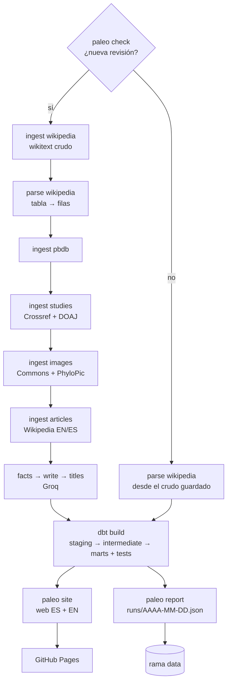

# Fase 1 — MVP: arcosaurios de 2026, en español e inglés

> Alcance y casillas: [`ALCANCE.md` §7, Fase 1](../../ALCANCE.md#fase-1--mvp-arcosaurios-bilingüe). Este documento explica el porqué.
> Web: <https://adaycuestacorrea.github.io/paleo-atlas/>

## 1. En una frase

Un pipeline de datos que cada día:
1. mira si Wikipedia ha publicado nuevas especies de arcosaurios (dinosaurios, aves, cocodrilos, pterosaurios…);
2. las cruza con bases de datos científicas;
3. escribe con un LLM una ficha **verificada** en inglés y en español;
4. publica una web estática.

Todo gratis y sin servidor.

## 2. El problema

Las especies fósiles nuevas se publican en revistas científicas, a menudo en inglés y de pago. La única lista que las reúne es una página anual de Wikipedia, en inglés y en formato de tabla wikitext. No existe un sitio que:
- las presente en español;
- diga **qué fiabilidad tiene cada estudio** (revisado por pares, preprint, retractado…);
- guarde **el historial** de cada especie;
- se actualice solo.

Detrás hay un reto de ingeniería de datos realista:
- fuentes heterogéneas, con formatos irregulares y retrasos (PBDB tarda semanas en añadir las especies nuevas);
- un LLM que **no puede inventarse nada**;
- una restricción dura de **0 €**.

## 3. Conceptos, desde cero

**ELT y capas.** *Extract-Load-Transform*:
- primero se **guarda la respuesta tal cual** (crudo);
- después se transforma con SQL en capas: **staging**, que limpia y tipa cada fuente por separado; **intermediate**, que cruza fuentes y aplica reglas; y **marts**, las tablas finales que lee la web (`dim_*` para entidades y `fct_*` para hechos o eventos).

Así, si una regla de negocio cambia, se recalcula todo desde el crudo sin volver a descargar.

**Idempotencia.** Ejecutar un paso dos veces deja el mismo resultado que ejecutarlo una. Aquí:
- la ingesta solo escribe una versión nueva si el contenido cambió ([`RawStore.save_if_changed`](../../src/paleo/store.py));
- el almacén DuckDB se **reconstruye entero** en cada ejecución.

Por eso los reintentos y las ejecuciones manuales son seguros.

**Estado en git (D3).** No hay base de datos alojada. Las respuestas crudas, versionadas por fecha (`raw/<fuente>/<tipo>/<clave>/<fecha>.json`), los textos generados y el registro de ejecuciones viven en la rama `data` del repositorio. Git aporta historial, auditoría y copia de seguridad gratis. El almacén es un archivo DuckDB desechable.

**Detección de cambios barata (D10).** Antes de ejecutar nada caro, `paleo check` pregunta a la API de Wikipedia por el número de la última revisión de la página. Si no ha cambiado, no se descarga nada ni se gasta LLM.

**SCD tipo 2** (*Slowly Changing Dimension*). Es la forma de guardar la **historia** de una entidad que cambia poco a poco: cada versión es una fila con `valid_from`/`valid_to`, y una fila nueva solo se abre cuando cambia algún campo. Aquí se calcula en SQL a partir de las versiones crudas guardadas en git ([`int_new_taxa_history`](../../dbt/models/intermediate/int_new_taxa_history.sql)). Cada cambio (estatus, autores, edad, localidad, estudio…) se convierte en un evento `entry_changed` del historial de la especie.

**Tests de datos.** Igual que el código tiene tests, los datos también:
- `unique` y `not_null` en las claves;
- `relationships`: todo texto apunta a un taxón que existe;
- `accepted_values`;
- tests propios en SQL. Por ejemplo, ninguna imagen mostrada tiene una licencia fuera de la lista blanca, y la última detección de cambios no tiene más de 2 días.

Algunos son **avisos** (PBDB no tiene todavía la especie) y otros **errores**.

**LLM con hechos con fuente (*grounding*).** El LLM no escribe «sobre Spinosaurus» de memoria:
1. lee fragmentos de las fuentes y extrae **hechos atómicos**, cada uno con la cita exacta del fragmento de origen;
2. el código comprueba que esa cita está de verdad en el fragmento, y si no, descarta el hecho;
3. la redacción se hace **solo** con esos hechos, y cada frase dice qué hechos usa.

**Verificación determinista.** El código, no el modelo, comprueba cada texto:
- **fidelidad:** cada nombre, número y fecha del texto aparece en los hechos;
- **anti-copia:** ninguna secuencia de 8 palabras igual a la fuente (con al menos 4 palabras corrientes). Es lo que permite publicar con licencia NC sin vulnerar la CC BY-SA de Wikipedia;
- **una cita por frase**, sin hechos repetidos y con la longitud dentro de límites.

Si falla, se reintenta con los errores concretos. Si vuelve a fallar, la web muestra un **texto de respaldo** hecho con plantilla.

**Web estática.** HTML generado de antemano con Jinja2: sin servidor, sin base de datos en producción y gratis en GitHub Pages. El buscador funciona en el navegador con un índice JSON.

**Cron de GitHub Actions.** Ejecuta el workflow a una hora fija, pero **no es puntual**: a las horas en punto puede retrasarse o descartarse (ver §8).

## 4. Cómo funciona aquí



**Por bloques:**

1. **Wikipedia → filas.** [`ingest/wikipedia.py`](../../src/paleo/ingest/wikipedia.py) guarda cada revisión de la página «2026 in archosaur paleontology» con la API de MediaWiki, nunca raspando el HTML. [`parse/wikipedia.py`](../../src/paleo/parse/wikipedia.py) convierte la tabla en filas con `mwparserfromhell`: nombre, estatus, autores, edad, unidad, localidad, referencias. También saca los **estudios sobre taxones ya conocidos** de las secciones de investigación, que son los futuros eventos «Nuevo estudio». El wikitext es irregular, así que el parser se prueba con revisiones reales guardadas como fixtures.
2. **Enriquecer:**
   - [PBDB](../../src/paleo/ingest/pbdb.py) aporta taxonomía y rango temporal;
   - [Crossref](../../src/paleo/ingest/crossref.py), el tipo de publicación, la revista, las retracciones y las correcciones;
   - [DOAJ](../../src/paleo/ingest/doaj.py), si la revista es de acceso abierto;
   - [Commons y PhyloPic](../../src/paleo/ingest/images.py), imágenes y siluetas con licencia permitida;
   - [artículos](../../src/paleo/ingest/articles.py) de Wikipedia EN y ES, como fuente de hechos.

   Cada fuente tiene su frescura: PBDB, imágenes y artículos cada 7 días; Crossref y DOAJ cada 30. Los abstracts de Crossref **nunca** van al crudo público, solo a la caché local.
3. **dbt.** En `dbt/models/`:
   - el staging de cada fuente;
   - las páginas de taxones nuevos y conocidos (`int_taxon_pages`);
   - la resolución de nombres de los estudios (`int_research_taxon_links`);
   - la mejor imagen por taxón, por niveles: especie > género > clado > grupo;
   - las señales de fiabilidad de cada estudio (`int_study_reliability`);
   - el historial SCD2;
   - los marts `dim_taxon`, `dim_study`, `fct_taxon_event`, `fct_taxon_text` y `fct_taxon_image`.
4. **Fichas narrativas** ([`narrative/`](../../src/paleo/narrative/)):
   - `facts.py` extrae y comprueba los hechos;
   - `write.py` redacta en inglés, adapta al español frase a frase con las mismas citas y pasa una revisión de estilo;
   - `checks.py` verifica.

   La capa [`llm.py`](../../src/paleo/llm.py) es intercambiable (Ollama local o Groq). Pide salida JSON validada con un esquema, respeta la cuota con un limitador y guarda una caché por contenido, de modo que una ficha solo se regenera si cambian sus hechos o el prompt.
5. **Web** ([`site/`](../../src/paleo/site/)):
   - portada con «Última hora»;
   - ficha con historial, imagen, galería, fuentes y distintivos de fiabilidad;
   - recap semanal, «Cómo evaluamos las fuentes», «Fuentes y licencias» y buscador.

   `paleo site --check` comprueba antes de publicar enlaces, paridad de idiomas (`hreflang`), créditos y licencias de cada imagen, y el índice del buscador.
6. **Operación** ([`.github/workflows/pipeline.yml`](../../.github/workflows/pipeline.yml)):
   - cron a las 06:23 UTC, con reserva a las 10:47;
   - toda ejecución deja un registro en `runs/` ([`report.py`](../../src/paleo/report.py)) con fuentes cambiadas, totales, avisos de dbt, tokens y duración por paso;
   - un test de dbt falla si la última comprobación tiene más de 2 días;
   - el pie de la web muestra «fuentes comprobadas el…».

## 5. Por qué así

| Decisión | Alternativa descartada | Por qué |
|---|---|---|
| DuckDB en un archivo (D2) | Postgres alojado | Unos miles de filas: un motor analítico embebido sobra, cuesta 0 € y no hay que mantenerlo |
| Sin Spark en la capa diaria (D1) | Spark para todo | El volumen no lo justifica; Spark entra en la Fase 3, con GBIF, **medido** contra DuckDB |
| Estado en git y almacén reconstruido (D3) | Base de datos con estado | Auditable, gratis e idempotente; cualquier ejecución se puede reproducir desde un commit |
| SCD2 en SQL desde las versiones crudas (D9) | `dbt snapshots` | Los snapshots guardan estado entre ejecuciones; en CI y Actions el almacén se crea de cero cada vez y el historial se perdería |
| Hechos con fuente → prosa → verificación (D7) | Pedir al LLM «escribe una ficha» | Se puede comprobar con código; nada que no esté en una fuente llega a la web |
| Adaptar el inglés al español frase a frase | Redactar cada idioma por separado | Más barato (un solo texto que verificar a fondo) y coherente: las dos versiones citan los mismos hechos |
| Groq para el día a día, Ollama local para lotes (A18) | Una API de pago | Regla de 0 €. Groq `gpt-oss-120b`: 12/12 fichas de referencia verificadas en EN y ES. Qwen 3.5 9B local: sin cuota, para regenerar todo y evaluar |
| Web estática con Jinja2 (A5) | Un framework web o un CMS | Sin servidor, gratis y rápida; lo interactivo (buscador, visor) en JavaScript sin framework |
| Señales de fiabilidad visibles y simples | Una puntuación de fiabilidad | No juzgamos la ciencia: mostramos hechos comprobables (revisado por pares, preprint, retractado, DOAJ) y explicamos la regla |

## 6. Cómo se comprueba

- **pytest** (135 tests): parser con revisiones reales, ingestas con transporte simulado (sin red: idempotencia, frescura, «no encontrado», abstract eliminado), verificadores con casos buenos y malos, capa LLM con un modelo falso, informe de ejecución, web.
- **dbt** (127 tests): claves, relaciones, valores aceptados, licencias, frescura, retraso de PBDB (aviso hasta 8 semanas y error después, A7) y un test unitario del SCD2.
- **CI sin red** ([`ci.yml`](../../.github/workflows/ci.yml)): siembra los fixtures crudos y ejecuta el pipeline completo con `as_of` fijo, para que los tests con fechas no cambien con el tiempo.
- **Evaluación del LLM** ([`eval/`](../../eval/)): 12 fichas de referencia. Mide los hechos encontrados y dichos y cuántas fichas pasan las verificaciones, para comparar configuraciones.

```sh
uv run pytest -q
PALEO_DATA_DIR=/tmp/ci uv run python scripts/seed_fixture_data.py
PALEO_DATA_DIR=/tmp/ci uv run paleo parse wikipedia --year 2026
(cd dbt && PALEO_DATA_DIR=/tmp/ci uv run dbt build --profiles-dir . --vars '{as_of: "2026-11-02"}')
PALEO_DATA_DIR=/tmp/ci uv run paleo site && PALEO_DATA_DIR=/tmp/ci uv run paleo site --check
```

## 7. Resultados reales (2026-11-02, de [`ALCANCE.md` §17](../../ALCANCE.md#17-métricas-del-proyecto-para-cv-y-entrevistas))

| Métrica | Valor |
|---|---|
| Especies nuevas de 2026 recogidas | 82 de 82 |
| Fichas en la web | 280 (82 nuevas + 198 conocidas citadas en estudios) |
| Fichas narrativas verificadas | EN 82/82 · ES 81/82 (la que falta muestra el texto de respaldo) |
| Hechos que pasan la comprobación | 78 % (1685 de 2158) |
| Fichas con imagen | 100 % (especie 36 % · género 4 % · clado 49 % · grupo 11 %) |
| Estudios revisados por pares | 94 % (28 % en revistas DOAJ; 5 corregidos, 0 retractados) |
| Correspondencia con PBDB | Nuevas 41 % (PBDB tarda en añadirlas) · conocidas 99 % |
| Eventos en el historial | 313 |
| Evaluación de Groq `gpt-oss-120b` (12 de referencia) | 12/12 verificadas EN y ES; hechos encontrados 0,385; dichos en el texto 0,384 |
| Pipeline diario completo sin LLM | ~1 min |
| Coste | 0 € |

## 8. Qué salió mal y qué se aprendió

- **El primer cron (06:00 UTC) no se lanzó.** GitHub retrasa o descarta los cron a las horas en punto, cuando hay más carga. Solución: hora «rara» (06:23), un cron de reserva (10:47) que no hace nada si ya hubo ejecución, y un test de frescura y una fecha en el pie para que un fallo se vea. *Lección:* lo programado también hay que vigilarlo.
- **El lote nocturno de fichas se paró en la 7.ª especie.** El modelo local devolvió un JSON cortado y una excepción detuvo todo. Ahora la respuesta cortada se reintenta con el doble de tokens, y si vuelve a fallar se salta esa especie y el lote sigue. *Lección:* en un lote, un elemento malo no puede tumbar a los demás.
- **Errores que se parecían a «sin cambios».** `paleo check` trataba un error de red igual que «no hay nada nuevo», así que podían perderse días en silencio. Ahora sale con 2 y el pipeline lo ejecuta todo, para que el fallo aparezca.
- **Las comprobaciones rechazaban buen español.** «Cocodrilomorfos» no coincidía literalmente con *Crocodylomorpha*. Se aceptan los clados por encima de familia escritos en español, pero nunca géneros ni especies.
- **PBDB recibía nombres que no eran taxones** («Albian», «Brazil»…), porque se partía cualquier enlace por su primera palabra. Se filtran periodos, países y adjetivos: de 637 nombres consultados se pasó a 452, sin perder ninguna página.
- **DOAJ devolvía 403.** Bloquea los User-Agent que contienen «bot», justo la palabra que pide Wikimedia. DOAJ usa ahora su propio User-Agent, igual de descriptivo, sin esa palabra.
- **Mamíferos en una web de arcosaurios**, porque eran presas citadas en estudios de cocodrilos. Se filtran las clases fuera del alcance (§4).
- **Previsión equivocada de la cuota de Groq.** Dije que la evaluación no terminaría en un día, y terminó gracias a la caché por contenido. *Lección:* medir antes de prever.

## 9. Preguntas de entrevista

**¿Por qué DuckDB y no Postgres o un *warehouse* en la nube?**
Son unos miles de filas y una carga analítica de lectura. DuckDB es un motor columnar embebido en un archivo: cero mantenimiento, cero coste y SQL completo para dbt. Lo reconstruyo entero en cada ejecución, en unos segundos.

**¿Por qué no usas Spark?**
Porque el volumen diario no lo justifica: sería complejidad sin beneficio. Spark entra en la Fase 3, con GBIF (millones de registros), y lo compararé con DuckDB haciendo el mismo trabajo, con cifras.

**¿Cómo evitas que el LLM se invente datos?**
No le pido que escriba de memoria:
- extrae hechos con su cita exacta, y el código descarta los que no están en el fragmento;
- redacta solo con esos hechos, citando cada frase;
- el código comprueba nombres, números y fechas contra los hechos, además de copia literal y citas.

Si algo falla y los reintentos no lo arreglan, se publica una plantilla y no el texto del modelo.

**¿Qué pasa si Wikipedia cambia el formato de la tabla?**
Que el parser falla o devuelve menos filas. Los tests con revisiones reales lo detectan, el informe de ejecución muestra los totales y su cambio, y la web anterior sigue publicada: nunca se publica una web rota. El crudo está guardado, así que tras arreglar el parser se reprocesa sin descargar nada.

**¿Cómo sabes que el pipeline ha corrido?**
Cada ejecución, también sin cambios, escribe `runs/<fecha>.json` en la rama `data`. Un test de dbt falla si la última comprobación tiene más de 2 días, y el pie de la web dice cuándo se comprobaron las fuentes.

**¿Cómo guardas el historial si el almacén se borra en cada ejecución?**
El historial no vive en el almacén, sino en las versiones crudas de git. El SCD2 se recalcula en SQL desde esas versiones, así que es reproducible desde cualquier commit.

**¿Cuánto cuesta?**
0 €: GitHub Actions y Pages (repositorio público), APIs públicas, el plan gratuito de Groq con un limitador que nunca lo supera y la GPU propia para los lotes grandes.

## 10. Límites y lo que queda

- **Cierre pendiente:** que el cron se lance solo y 2 semanas seguidas sin intervención.
- 1 ficha en español con texto de respaldo (su versión copiaba 8 palabras de Wikipedia ES).
- ZooBank no tiene API disponible. El distintivo «Nombre registrado» queda para la Fase 3.
- Pasan a la [Fase 3](../../ALCANCE.md#fase-3--enciclopedia-ampliación-y-spark):
  - toda la enciclopedia, no solo especies nuevas;
  - reptiles marinos y peces fósiles;
  - el historial hacia atrás;
  - «En debate»;
  - «Recogido en PBDB»;
  - el significado del nombre.
