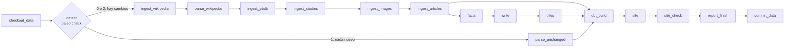

# Fase 2 — Airflow

> Alcance y casillas: [`ALCANCE.md` §7, Fase 2](../../ALCANCE.md#fase-2--airflow). Este documento explica el porqué.

## 1. En una frase

El mismo pipeline que GitHub Actions ejecuta cada día, convertido en DAGs de **Airflow 3.3** que corren en Docker en local. Se ha **demostrado** que producen exactamente el mismo resultado.

## 2. El problema

En la Fase 1 el pipeline ya funcionaba con GitHub Actions: un archivo YAML con pasos que se ejecutan uno detrás de otro. Faltaban dos cosas:

1. **Airflow es el orquestador que más piden las ofertas de Data Engineer.** Hay que saber usarlo de verdad, no solo nombrarlo.
2. **Comprobar el diseño D4** (los comandos no dependen del orquestador). Si el pipeline está bien hecho, cambiar de orquestador no debería obligar a tocar ni una línea del código del pipeline. Esta fase lo demuestra: `src/paleo/`, `dbt/` y `pipeline.yml` no se han tocado.

## 3. Conceptos, desde cero

**Orquestador.** Un programa que decide *qué* se ejecuta, *cuándo* y *en qué orden*, y qué hacer si algo falla. No hace el trabajo: llama a quien lo hace. Aquí el trabajo lo hacen los comandos `paleo`.

**DAG** (*Directed Acyclic Graph*, grafo dirigido acíclico). Es la forma de describir un pipeline como **tareas unidas por flechas de dependencia**:
- *dirigido*, porque una flecha indica que A va antes que B;
- *acíclico*, porque no hay vueltas: si A depende de B, B no puede depender de A.

Gracias a eso siempre existe un orden válido de ejecución, y Airflow puede lanzar en paralelo las tareas que no dependen unas de otras.

**Tarea y operador.** Una tarea es un nodo del DAG. El operador es el tipo de tarea:
- `BashOperator` ejecuta un comando de shell; aquí se usa casi siempre;
- `@task` ejecuta una función de Python;
- `@task.branch` es una función que elige por qué camino sigue el DAG;
- `EmptyOperator` no hace nada y se usa como marcador.

**Rama condicional (*branch*).** La tarea `detect` ejecuta `paleo check`, que sale con 0 (hay cambios), 1 (nada nuevo) o 2 (no se pudo comprobar). Según el resultado, el DAG sigue por la ingesta completa o solo reconstruye. La rama no elegida queda en **skipped** (saltada), no en fallo.

**Trigger rule (regla de disparo).** Indica cuándo se ejecuta una tarea según cómo acabaron las anteriores. Por defecto es `all_success`, es decir, solo si todas las anteriores fueron bien. Aquí se usan tres más:

| Regla | Significa | Dónde |
|---|---|---|
| `none_failed_min_one_success` | Ninguna anterior falló y al menos una fue bien | `dbt_build`: llega desde la rama de ingesta **o** desde la de «sin cambios» |
| `all_done` | Se ejecuta pase lo que pase | `report_finish` y `commit_data`, como `if: always()` en Actions |
| `one_failed` | Solo si algo falló | `fail_if_any_failed`, la tarea vigilante (ver §8) |

**Reintentos con espera exponencial.** Si una tarea de red falla, Airflow la vuelve a lanzar tras ~1 minuto, y si vuelve a fallar espera aproximadamente el doble, con un máximo de 10. Un corte de red de un minuto no tumba el pipeline. Actions no tiene reintentos por paso.

**Piezas de Airflow 3:**
- **scheduler:** decide qué tarea toca;
- **dag-processor:** lee los archivos `.py` de los DAGs;
- **api-server:** sirve la interfaz web y la API, y las tareas le informan de su estado;
- **metadata DB (Postgres):** guarda el historial de ejecuciones.

**Executor.** Es *dónde* se ejecutan las tareas:
- **LocalExecutor:** como subprocesos en la máquina del scheduler. Basta para un pipeline pequeño;
- **CeleryExecutor:** en *workers* separados, coordinados con Redis. Sirve para repartir carga entre máquinas. Aquí sería peso muerto.

**`catchup` y `max_active_runs`.**
- `catchup=False`: si el DAG estuvo apagado una semana, al encenderlo **no** recupera las 7 ejecuciones perdidas. Este pipeline siempre trabaja sobre «lo último publicado», así que recuperar días pasados no aporta nada.
- `max_active_runs=1`: nunca hay dos ejecuciones a la vez escribiendo en los mismos datos. Es el equivalente a `concurrency: pipeline` en Actions.

## 4. Cómo funciona aquí



*(Más la tarea `fail_if_any_failed`, que depende de todas.)*

**Archivos:**

| Archivo | Qué hace |
|---|---|
| [`airflow/Dockerfile`](../../airflow/Dockerfile) | Parte de la imagen oficial `apache/airflow:3.3.2-python3.14` e instala `paleo` en **su propio venv** (`/opt/paleo/.venv`) |
| [`airflow/docker-compose.yaml`](../../airflow/docker-compose.yaml) | Postgres, init, api-server, scheduler y dag-processor, con LocalExecutor. Interfaz en `127.0.0.1:8080`, sin contraseña porque solo es local |
| [`airflow/dags/paleo_steps.py`](../../airflow/dags/paleo_steps.py) | La **lista única de pasos**: nombre de la tarea y comando `paleo`, en el orden de `pipeline.yml`. Python puro, sin Airflow |
| [`airflow/dags/paleo_pipeline.py`](../../airflow/dags/paleo_pipeline.py) | Monta los 4 DAGs a partir de esa lista |
| [`airflow/bin/step.py`](../../airflow/bin/step.py) | Ejecuta cada comando y apunta su resultado y sus horas con el formato de la API de jobs de GitHub |
| [`airflow/bin/init-work.sh`](../../airflow/bin/init-work.sh) | Clona la rama `data` en `airflow/work/data` con el push desactivado |

**Los 4 DAGs**, todos pausados al crearse:

| DAG | Cuándo | Qué hace |
|---|---|---|
| `paleo_daily` | Mar–dom, 06:23 UTC | Detección de cambios; el pipeline completo solo si cambió algo |
| `paleo_weekly` | Lunes, 06:23 UTC | Todo, sin detección (en Actions el lunes también se lo salta, por el recap semanal) |
| `paleo_monthly` | Día 1 | Provisional: todas las fuentes otra vez, ignorando la frescura (retracciones, correcciones, DOAJ). GBIF llega en la Fase 3 |
| `paleo_ci_parity` | Bajo demanda | El job de fixture del CI, para comparar su resultado con el del CI |

**Recorrido de una ejecución diaria:**
1. `checkout_data`: `git fetch` y `git reset --hard` de la rama `data`, más `git clean -fdx`. Así se parte del mismo estado que Actions, que hace un checkout limpio.
2. `detect`: `paleo check` y luego `paleo report start --changed` o `--no-changed`.
3. Una de las dos ramas, después dbt, la web y su comprobación.
4. `report_finish`: `paleo report finish --jobs <archivo de step.py>` escribe el registro en `runs/`, el mismo que escribe Actions.
5. `commit_data`: el commit en el clon, con la misma salvaguarda que Actions (se niega si hay `cache/`, `interim/` o `.duckdb`). **Sin push.**

## 5. Por qué así

- **Una lista única de pasos, comprobada por un test.** Escribir los comandos dos veces, en el YAML y en el DAG, llevaría tarde o temprano a que no coincidieran. [`tests/test_airflow_steps.py`](../../tests/test_airflow_steps.py) lee `pipeline.yml` y `paleo_steps.py` y exige los mismos comandos, en el mismo orden y con los mismos argumentos. Solo se ignoran las opciones que indican *dónde* o *cómo* corre (`--trigger`, `--out`, `--jobs`, `--provider`). Si alguien cambia uno sin el otro, el CI falla.
- **`paleo` en su propio venv dentro de la imagen.** Airflow trae cientos de dependencias, y dbt otras tantas. Mezclarlas acaba en conflictos de versiones. Con dos entornos separados, las tareas llaman a `/opt/paleo/.venv/bin/paleo` y Airflow no ve las librerías de `paleo`. Es la misma idea que D4, llevada a las dependencias.
- **No publica (decisión del usuario).** Si Airflow también hiciera push a la rama `data` y desplegara Pages, habría dos escritores compitiendo. Actions es el único que publica, y Airflow trabaja sobre un clon desechable.
- **No usa Groq (decisión del usuario).** El plan gratuito de Groq da 200 000 tokens al día por cuenta, y los gasta Actions. El paso narrativo se salta por defecto. Con `narrative=ollama` usa la GPU local, pero hay que pedirlo.
- **Airflow 3.3 y no 2.x (A8).** Es la versión actual: Task SDK, interfaz nueva y dag-processor separado. Las imágenes oficiales ya traen Python 3.14, el del proyecto.
- **Pausados al crearse.** Un DAG de demostración no debe ponerse a consultar Wikipedia, PBDB y Crossref por su cuenta en cuanto arrancas Docker.

## 6. Cómo se comprueba que da «exactamente el mismo resultado»

Es el criterio de cierre de la fase. Se comprueba de tres formas, cada una más fuerte que la anterior:

1. **Mismos comandos:** el test de §5. Corre en el CI de siempre, sin Airflow.
2. **Misma salida con la misma entrada:**
   - [`scripts/fingerprint.py`](../../scripts/fingerprint.py) calcula una **huella** de una ejecución: un hash SHA-256 por tabla del almacén DuckDB (de sus filas, ordenadas) y uno por archivo de la web.
   - El CI la calcula en su job de fixture y la sube como artefacto.
   - [`scripts/parity.py`](../../scripts/parity.py) lanza el DAG `paleo_ci_parity`, que repite ese job dentro de Docker, descarga con `gh` la huella del CI **del mismo commit** y las compara tabla a tabla y archivo a archivo.
   - Antes de nada se comprobó que la huella es estable: dos ejecuciones seguidas dan la misma.
3. **Con datos reales:** la ejecución diaria del DAG sobre el clon del día y la de Actions de ese día deben dar los mismos totales en `runs/`.

Además, un job del CI (`dags`) instala Airflow 3.3.2 y carga los DAGs con [`airflow/tests/test_dag_integrity.py`](../../airflow/tests/test_dag_integrity.py), que comprueba:
- que no hay errores de importación;
- la forma de la rama condicional;
- las trigger rules;
- los reintentos;
- que nunca se hace push.

**Para reproducirlo:**
```sh
cd airflow
./bin/init-work.sh
GIT_SHA=$(git rev-parse HEAD) docker compose up -d --build
cd .. && uv run python scripts/parity.py      # needs CI to have run for HEAD
```

## 7. Resultados reales (2026-11-02)

| Prueba | Resultado |
|---|---|
| Paridad con el CI, commit `0e02541` | **0 diferencias** en 33 tablas y 97 archivos de la web |
| Diaria con datos reales frente a Actions del mismo día | Iguales: totales (82 nuevos, 202 conocidos, 317 eventos…), PBDB, imágenes por nivel, eventos por tipo y resultado de dbt (92 pass, 2 warn) |
| Reintento real | Bloqueado `en.wikipedia.org` en el contenedor: `ingest_wikipedia` falla con «Connection refused» en el 1.<sup>er</sup> intento y pasa en el 2.º; la ejecución acaba en verde (capturas en el README) |
| Ejecución sin cambios | dbt ~7 s; la web y su comprobación ~1 s cada una |
| Tests | 4 de carga de DAGs (job `dags`) y 4 de paridad de comandos (en pytest) |

## 8. Qué salió mal y qué se aprendió

- **`dbt` no aparecía (`Permission denied: 'dbt'`).** `paleo build` llama a `dbt` por el PATH. En Actions eso funciona porque `uv run` activa el venv. En Airflow nadie lo activaba. *Lección:* un orquestador nuevo hereda también las suposiciones implícitas del anterior. Las tareas añaden ahora el venv al PATH, que es exactamente lo que hacía `uv run`.
- **Una ejecución con dbt roto terminaba en verde.** Airflow decide el estado de una ejecución por sus **últimas** tareas, y `report_finish` y `commit_data` se ejecutan siempre (`all_done`) y salían bien. Se añadió una **tarea vigilante**, `fail_if_any_failed`, con `one_failed`, que depende de todas: si algo falla, falla ella y la ejecución queda en rojo, como el job de Actions. Es un patrón conocido de Airflow.
- **El DAG se quedaba en cola.** El script de pruebas pausaba el DAG justo después de lanzarlo, y Airflow no programa las ejecuciones de un DAG pausado. *Lección:* pausar es «no ejecutar», no solo «no programar».
- **Faltaba gcc en la imagen.** `mwparserfromhell` no tiene wheel para el Python 3.14 de la imagen y hay que compilarlo.
- **Las dataclasses y `importlib`.** Para cargar `paleo_steps.py` desde un test sin Airflow hay que registrarlo en `sys.modules` antes de ejecutarlo, porque las dataclasses buscan allí su módulo.

## 9. Preguntas de entrevista

**¿Por qué Airflow si ya tienes GitHub Actions?**
Actions es un ejecutor de CI con cron: sirve, es gratis y es lo que publica. Airflow aporta lo que pide un pipeline de datos serio: reintentos por tarea, ramas condicionales, historial de ejecuciones con logs por tarea, backfill y una interfaz para operarlo. Lo importante es que el pipeline no depende de ninguno de los dos: los dos llaman a los mismos comandos, y lo he demostrado con una huella de la salida.

**¿Qué es idempotente en tu DAG?**
Todo paso puede repetirse sin efectos raros:
- la ingesta solo guarda una versión nueva si el contenido cambió (`RawStore.save_if_changed`);
- el almacén se reconstruye entero en cada ejecución (D3);
- la web se genera en una carpeta temporal y sustituye a la anterior;
- el checkout parte siempre del último estado publicado.

Por eso los reintentos son seguros.

**¿Por qué `catchup=False`?**
El pipeline procesa «lo último publicado», no «los datos del día X». Recuperar días atrasados repetiría el mismo trabajo sin aportar nada. Si los datos estuvieran particionados por fecha, sí lo activaría.

**¿Cómo pruebas un DAG en CI?**
En dos niveles:
- sin Airflow, un test compara los comandos con los del workflow;
- con Airflow, un job carga los DAGs con `DagBag` y comprueba que no hay errores de importación, la forma del grafo y la configuración (trigger rules, reintentos).

Además, la paridad de salida se comprueba con una huella.

**¿Cómo lo escalarías?**
- Pasar a CeleryExecutor o KubernetesExecutor con workers.
- Paralelizar las ingestas independientes. Hoy van en cadena para reproducir el orden de Actions, aunque PBDB, Crossref y las imágenes podrían ir en paralelo.
- Mover el estado a un almacenamiento de objetos en vez de un clon de git.
- Con datos particionados por fecha, usar backfill.

**¿Qué pasa si una fuente se cae?**
Primero reintenta el cliente HTTP de `paleo`, con espera exponencial durante ~1 min. Después reintenta Airflow dos veces más, con ~1 y ~2 minutos de espera. Si aun así falla, la ejecución se marca en rojo, pero el informe y el registro se escriben igual. En Actions, la web anterior sigue publicada.

## 10. Límites y lo que queda

- El paso narrativo con Ollama (`narrative=ollama`) no se ha ejecutado desde Airflow. Requiere que Ollama escuche en una dirección accesible desde Docker (`OLLAMA_HOST=0.0.0.0`).
- `paleo_monthly` es provisional. El DAG mensual real, con GBIF y el job de Spark, llega en la [Fase 3](../../ALCANCE.md#fase-3--enciclopedia-ampliación-y-spark).
- Las ingestas van en cadena para reproducir el orden de Actions, aunque se podrían paralelizar.
