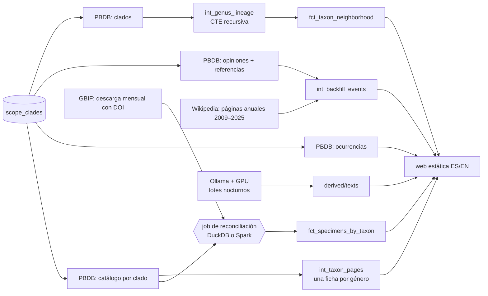

# Fase 3 — Enciclopedia, ampliación y Spark

> Alcance y casillas: [`ALCANCE.md` §7, Fase 3](../../ALCANCE.md#fase-3--enciclopedia-ampliación-y-spark). Este documento explica el porqué.
>
> **Estado (2026-11-03): en curso.** Hitos 1–5 y 7 hechos; el hito 6 (fichas narrativas de los géneros) avanza en lotes nocturnos. Se termina de escribir al cerrar la fase.

## 1. En una frase

Paleo Atlas pasa de ser un registro de las especies nuevas de 2026 a una **enciclopedia de 4.751 géneros**: arcosaurios, reptiles marinos y peces fósiles. Cada ficha tiene mapa, museos, historial hacia atrás desde 1758, árbol de parentesco y, poco a poco, texto narrativo verificado. Por el camino, el mismo job se ha escrito en **Spark y en DuckDB** y se ha medido cuál conviene.

## 2. El problema

Al acabar la Fase 1, la web tenía 82 especies nuevas y unas 200 fichas básicas de taxones conocidos. Para que fuera una enciclopedia de verdad faltaban:

1. **Todos los géneros de los grupos de §4**, no solo los que salen en las noticias del año.
2. **Otros grupos además de los arcosaurios**: reptiles marinos y peces fósiles.
3. **Dónde se encontraron y dónde están los fósiles**: las ocurrencias de PBDB y los especímenes de museo de GBIF. Unir los nombres de GBIF con los de PBDB es un problema de reconciliación con casi un millón de registros, y ahí es donde se plantea Spark.
4. **La historia de cada nombre** antes de 2026, y **su lugar en el árbol de la vida**.
5. **Texto narrativo** para miles de géneros sin gastar dinero. El plan gratuito de Groq da para unas pocas especies al día, no para 2.743 géneros.

Hay una restricción que lo condiciona todo: **la Fase 1 está cumpliendo sus 2 semanas de ejecución autónoma.** Nada de esta fase puede tocar `main`, la rama `data` ni `pipeline.yml`. Todo va en `fase-3` (código) y `data-fase-3` (datos), con merge al cerrar la Fase 1.

## 3. Conceptos, desde cero

**El alcance como datos (seed).** Qué grupos entran no está escrito en el código, sino en una tabla CSV que dbt carga ([`dbt/seeds/scope_clades.csv`](../../dbt/seeds/scope_clades.csv)): un clado de PBDB por fila, con su bloque, su grupo, su prioridad y si está activo. Para ampliar el alcance se edita una fila, no el código.

**Catálogo frente a consulta por nombre.** En la Fase 1, PBDB se consultaba nombre a nombre. Para una enciclopedia hace falta la lista completa, así que se pide «todos los géneros y especies aceptados bajo *Dinosauria*» (`taxon_status=accepted`). Se usa `accepted` y no `valid`, porque PBDB cuenta los sinónimos como válidos y saldría *Manospondylus* como especie de *Tyrannosaurus*.

**Reconciliación de nombres.** GBIF y PBDB no escriben igual los nombres. Se buscan tres tipos de coincidencia, en este orden:
1. **Exacta**;
2. **Sinónimo**: GBIF cambió el nombre a otro que PBDB no usa, pero el nombre original del registro sí es un género de PBDB;
3. **Errata**: una sola letra de distancia (Levenshtein ≤ 1) de un único género de PBDB, con la misma inicial y la misma familia.

Es el problema clásico de *entity resolution*.

**Spark frente a DuckDB.**
- **Spark** reparte el trabajo entre muchas máquinas (o núcleos), con un coste fijo de arranque: la JVM, la sesión y la planificación.
- **DuckDB** es una base de datos analítica que corre dentro del propio proceso, en una sola máquina, sin arranque.

La pregunta no es cuál es mejor, sino **a partir de qué volumen compensa repartir**.

**Cierre transitivo con una CTE recursiva.** PBDB solo dice quién es el padre de cada clado. Para saber todos los ancestros de un género (44 niveles en *Spinosaurus*) se usa `with recursive`: se empieza en el padre y se va subiendo hasta la raíz. El resultado es una tabla «género × ancestro × profundidad».

**Historial «seguido» frente a «reconstruido».**
- Lo **seguido** (`origin = tracked`) lo hemos visto pasar desde que arrancó el proyecto, con fecha exacta.
- Lo **reconstruido** (`origin = backfill`) se deduce después, de fuentes que solo dan el año.

Las dos cosas van en la misma tabla de eventos, pero no se tratan igual.

**LLM local por lotes.** Un modelo de 9.000 millones de parámetros (Qwen 3.5 9B) corre en la GPU de casa con Ollama. Es gratis, pero tarda unos 2 minutos por género, así que trabaja de noche, con hora de parada, y retoma donde lo dejó.

## 4. Cómo funciona aquí

**Los hitos:**

| Hito | Qué | Piezas principales |
|---|---|---|
| H1 | Catálogo de PBDB y una ficha por género (3.040 arcosaurios) | `scope_clades`, `ingest_catalog`, `int_catalog_genera`, `int_taxon_pages` |
| H2 | Índices por grupo, época y país; ocurrencias; artículo de Wikipedia **verificado** con Wikidata; siluetas | `int_genus_wikipedia`, `paleo/site/indices.py` |
| H3 | Reptiles marinos (358 géneros) y peces fósiles (1.353) | `paleo/scope.py` (la regla de alcance en un solo sitio), seed `featured_fishes` |
| H4 | Historial hacia atrás: opiniones de PBDB y páginas anuales 2009–2025 | `int_opinion_events`, `int_backfill_events`, `raw/wikipedia_past` |
| H5 | GBIF, el job en DuckDB y en Spark, el benchmark, el mapa y los museos, y el DAG mensual | `paleo/gbif_job/`, `spark/jobs/gbif_reconcile.py`, [`benchmarks/gbif/`](../../benchmarks/gbif/results.md) |
| H6 | Fichas narrativas de los géneros con artículo (2.743), con la GPU local *(en curso)* | `paleo narrate --scope genera --until HH:MM`, `genus_chunks_for` |
| H7 | Clasificación completa y árbol de parentesco | `int_genus_lineage`, `fct_taxon_neighborhood`, `paleo/site/tree.py` |

**Frecuencia de cada fuente** (todo cabe en el plan gratuito):

| Fuente | Qué se baja | Cada cuánto |
|---|---|---|
| PBDB | Catálogo por clado; ocurrencias, opiniones y clados por bloque | Mensual (`RawStore.is_fresh`, 30 días) |
| GBIF | Una descarga filtrada con DOI (932.494 registros) | Mensual; se reutiliza si tiene menos de 28 días |
| Wikipedia | Páginas anuales antiguas (45) | Mensual; solo se guarda una revisión nueva |
| Wikidata | Artículo y elemento de cada género | Mensual |
| Ollama local | Hechos y textos de los géneros | Lotes nocturnos, cuando el usuario lo autoriza |

## 5. Por qué así

- **Una ficha por género, no por especie.** De la mayoría de las especies fósiles solo se sabe el nombre y un hueso. El género es la unidad que el público reconoce (*Spinosaurus*), y sus especies se listan dentro de la ficha. Las especies nuevas del año conservan su propia ficha y enlazan a la de su género.
- **El alcance se decide al parsear, en un solo sitio** (`paleo/scope.py`). Las páginas de reptiles y de peces incluyen tortugas, lagartos y miles de peces óseos que no entran en §4. Si el filtro estuviera en dbt, la ingesta habría gastado peticiones a PBDB, Crossref y Commons, y cuota de LLM, en taxones que nunca tendrán ficha. Filtrando al parsear, de 259 especies nuevas de las tres páginas solo 114 siguen adelante.
- **El artículo de Wikipedia se verifica, no se adivina.** Un título que coincide con el nombre no basta: el elemento de Wikidata de la polilla *Coloradia* llevaba por error el ID de PBDB del dinosaurio. Se exige que el elemento tenga el ID de PBDB (P842) **y** que su ascendencia (P171) pase por el clado del bloque.
- **DuckDB por defecto, Spark en el DAG mensual.** El benchmark (§7) dice que, con un millón de filas, DuckDB es 15–17 veces más rápido. Aun así, el DAG mensual de Airflow ejecuta la variante de Spark a propósito, para que el job de Spark funcione de verdad en un orquestador. Las huellas demuestran que los dos dan el mismo resultado. Cuesta 13 s al mes.
- **Una sola especificación del job** (`paleo/gbif_job/spec.py`): las reglas de reconciliación se escriben una vez y las dos implementaciones las siguen. Un test con fixture exige extractos idénticos, y con los datos reales se comparan las huellas SHA-256.
- **Lo antiguo no se mezcla con lo del año.** Las páginas anuales de 2009–2025 van a otra carpeta (`raw/wikipedia_past`, `interim/wikipedia_past`). Varios pasos leen *todas* las páginas anuales del almacén intermedio: la lista de nombres para PBDB, los DOIs para Crossref, las especies que redacta el LLM y las fichas `new` y `known`. Mezclarlas habría dado miles de especies «nuevas» para Groq. En carpeta aparte, solo alimentan eventos.
- **Un evento por cambio de estado, no por opinión.** PBDB guarda una opinión por cada autor que usó un nombre, y los autores discrepan durante décadas: *Brontosaurus* es sinónimo de *Apatosaurus* para Riggs en 1903, válido para Romer en 1966 y otra vez sinónimo en 1970. Un evento por opinión daría una línea temporal que va y viene. La regla es la **primera** vez que un nombre recibe cada estado, más la **revalidación** cuando la clasificación actual de PBDB lo vuelve a aceptar (Tschopp y colaboradores, 2015).
- **Lo reconstruido no es noticia.** Los eventos `backfill` no entran en «Última hora» ni en los resúmenes semanales; si entraran, aparecerían semanas de 2015. Sus ~7.600 estudios no se buscan en Crossref, porque serían ~100 MB más en git: salen como `unchecked`, sin distintivo, y la página «Cómo evaluamos las fuentes» lo explica.
- **Árbol de PBDB, no de Open Tree of Life** (decisión del usuario). Open Tree reconoce 631 de 1.000 géneros fósiles, pero solo ~12 % están en su árbol sintético. Si se mezclaran las dos fuentes, el vecindario de un género de Open Tree tendría muy pocos parientes. La clasificación de PBDB cubre el 100 %, y la vista avisa de que es una clasificación, no un análisis filogenético.
- **Solo el vecindario, como SVG estático.** Dibujar 4.751 géneros no le sirve a nadie. Cada ficha enseña dos niveles: «Grupo» (el clado más bajo con al menos 3 géneros) y «Un nivel más arriba», con hasta 20 géneros, primero los más cercanos. El SVG se genera al construir la web, así que los enlaces funcionan sin JavaScript; el filtro por periodo es una mejora opcional.
- **El texto de los géneros, con la GPU de casa.** Con la cuota de Groq, 2.743 géneros tardarían meses. Ollama con Qwen 3.5 9B tarda ~137 s por género: unas 8–12 noches en total. El lote es **reanudable** (caché del LLM por contenido y salto de lo ya hecho), para **a una hora fija** y apaga el PC. Un vigilante lo detiene si la GPU pasa de 85 °C. El wikitext de los géneros (65 MB) se queda en la caché local; cada hecho cita la revisión exacta (`oldid`), así que no hace falta versionarlo.
- **Lecturas opcionales en dbt.** La rama `data` y el fixture del CI aún no tienen opiniones ni clados de PBDB, y DuckDB falla si un patrón de archivos no encuentra nada. Las macros comprueban primero con `glob()` y, si no hay archivos, devuelven una tabla vacía con los mismos tipos. El merge no rompe el pipeline diario.

## 6. Cómo se comprueba

- **Tests (183 de pytest; en dbt, 130 de datos y 8 unitarios):**
  - Tests unitarios de dbt para las reglas con más lógica: la elección del clado más específico de un género, las opiniones que dan evento y el nivel «grupo» del vecindario.
  - Tests de datos:
    - el linaje no tiene ciclos;
    - cada género aparece en su propio vecindario;
    - un solo `event_id` por evento;
    - `origin` y `reliability_status` solo con sus valores.
- **Paridad de motores:** `tests/test_gbif_job.py` exige que DuckDB y Spark den los mismos extractos con el fixture; con los datos reales se comparan las huellas.
- **CI con el fixture:** cada cambio se prueba también en un directorio vacío, con los datos del fixture del CI (sin opiniones, clados ni páginas antiguas), para asegurar que el pipeline diario sigue en verde tras el merge.
- **Las fuentes del texto no cambian sin querer.** Un script compara el `sources_hash` guardado en cada ficha de hechos con el de sus fuentes actuales. Después de H4 y de H7 dio 0 de 280: ningún hito obligó a rehacer los textos.
- **Lectura humana:** el primer lote de la GPU se leyó a mano en inglés y en español; de ahí salieron nuevas reglas en los prompts (§8). La web se revisa en el navegador, también con el ancho de móvil.

## 7. Resultados reales (2026-11-03)

| Qué | Resultado |
|---|---|
| Fichas | 4.930: 4.751 géneros (arcosaurios, reptiles marinos y peces), 115 especies nuevas y 64 taxones conocidos |
| Web | 10.330 páginas en ES y EN, generadas en ~4 s, con 0 problemas de enlaces |
| GBIF | 932.494 especímenes; reconciliados 138.388 en 1.739 géneros (exacto 118.371, sinónimo 17.052, errata 2.965) |
| Benchmark, 932.494 filas | DuckDB **0,86 s / 459 MB** · Spark 13,71 s / 1.504 MB · código: 124 frente a 242 líneas |
| Historial | 403 eventos seguidos + 19.354 reconstruidos (1758–2025) en 4.808 fichas |
| Árbol | 4.846 de 4.930 fichas (98 %); mediana del grupo: 27 géneros |
| Primer lote de la GPU | 201 géneros en ~7,5 h (137 s por género, 72 °C de media); verificados EN 90 % y ES 72 % |
| Coste | 0 € |

## 8. Qué salió mal y qué se aprendió

- **El árbol de GBIF no tiene los clados de §4.** No se puede pedir «Archosauria» a GBIF. Se descargan todos los cordados fósiles, sin mamíferos ni tortugas, y el filtro fino lo hace la reconciliación con PBDB. *Lección:* cada fuente tiene su propia taxonomía; el filtro va donde está la verdad, no donde es más cómodo.
- **Un ID equivocado en Wikidata.** *Coloradia*, una polilla, llevaba el ID de PBDB de un dinosaurio. Con el ID solo, su artículo habría salido en la ficha equivocada. *Lección:* comprobar dos señales independientes (el ID y la ascendencia).
- **`--limit` contaba antes de saltar lo hecho.** El lote nocturno habría repetido siempre los mismos géneros ya terminados. Ahora el límite se aplica después de saltar lo hecho, y lo comprueba un test.
- **El log del lote estaba en `/tmp`**, que se borra al apagar el PC, justo cuando el lote apaga el PC. Ahora los logs van a `~/.local/state/`.
- **Las fichas de los géneros no salían en la web**: el modelo de textos solo contemplaba las especies nuevas. Lo destapó la revisión de la mañana, no un test. Ahora hay cifras de géneros verificados en «Cómo evaluamos las fuentes».
- **El modelo pequeño escribe calcos en español** («superdepredador», «la forma del cuerpo», «Hacia 1875») que las verificaciones automáticas (fidelidad, anti-copia, cita por frase) no detectan. *Lección:* lo automático garantiza que el texto es fiel a las fuentes, pero no que esté bien escrito; hace falta leer una muestra. Se corrigió con reglas nuevas en los prompts y subiendo su versión, lo que reescribe esas fichas en el lote siguiente.
- **Una respuesta JSON cortada** en la extracción de hechos dejaba el género sin ficha. Ahora se vuelve a preguntar en dos mitades.
- **Las opiniones de PBDB van y vienen** (*Brontosaurus*): la primera versión daba eventos contradictorios cada pocos años. Se cambió a «primera vez de cada estado» y se fijó con un test unitario de dbt.
- **Una ventana SQL demasiado ancha** se comía la descripción original de cada género. La partición de «una descripción por nombre» no incluía el tipo de evento, así que un estudio con más prioridad le quitaba el sitio. Lo destapó revisar *Brontosaurus* a mano.
- **El ensayo del merge destapó dos fallos que los tests no veían:**
  - **Un PDF en la columna de imágenes** de la página de 2026 hace fallar la petición a Commons de todo su lote. Con el código de `main`, eso tumba `ingest images` y, con él, la publicación del día. Ahora solo se piden imágenes y, si un lote falla, se repite archivo a archivo.
  - **`fct_taxon_neighborhood` podía agotar la memoria** (12 GiB de disco temporal). Calculaba la cercanía de todos los géneros de niveles que llegan a los 4.787. Ahora solo busca dentro del clado más bajo donde caben los 20 que se muestran. El resultado es idéntico fila a fila (152.596 filas) y tarda 0,3 s en vez de ~4 s.
  
  *Lección:* ensayar con los datos reales y en las condiciones del runner, no solo con el fixture.
- **El escape de HTML de Jinja**: concatenar `<em>` con un valor ya escapado lo escapa también, y `Markup.replace` escapa lo que inserta. Las frases del historial se montan ahora en Python, con un test.

## 9. Preguntas de entrevista

**¿Por qué no usas Spark si lo tienes?**
Porque lo he medido. Con un millón de filas, DuckDB tarda 0,86 s y Spark 13,7 s, de los que unos 7,5 s son de arranque. Spark compensa cuando los datos no caben en una máquina o ya viven en un clúster: decenas o cientos de millones de filas, o un *lakehouse*. Lo tengo escrito, probado y orquestado, con paridad demostrada; elegir el motor es una decisión con datos, no de moda.

**¿Cómo reconcilias nombres entre fuentes?**
En tres pasadas, de más a menos segura: exacta, sinónimo (el nombre original del registro, antes de que GBIF lo cambiara) y errata (una sola letra, con la misma inicial y la misma familia, y solo si hay un único candidato). Cada coincidencia guarda cómo se hizo, y las coordenadas que GBIF marca como dudosas no van al mapa. Lo que no casa va a un extracto `unmatched` para revisarlo.

**¿Cómo modelas el historial?**
Con dos orígenes en una misma tabla de hechos. Lo seguido sale de un SCD tipo 2 calculado en SQL sobre las versiones crudas versionadas en git. Lo reconstruido sale de las opiniones de PBDB y de las páginas antiguas, con precisión de año. La columna `origin` decide qué es noticia y qué es historia.

**¿Cómo evitas que un cambio en una fuente dispare un gasto de LLM?**
Cada ficha guarda un hash de sus fuentes públicas y las versiones de sus prompts. Solo se rehace si cambia alguno de los dos. Antes de cerrar un hito compruebo que el hash de las 280 fichas no ha cambiado. Además, todo lo que alimenta al LLM se filtra por alcance al parsear.

**¿Por qué un LLM local y no una API?**
Por coste y por cuota: 2.743 géneros con el plan gratuito de Groq tardarían meses. Con la GPU de casa son unas 10 noches, a coste 0. Lo que exige: lotes reanudables, una hora de parada, un vigilante de temperatura y apagado automático. Las mismas verificaciones de fidelidad sirven para los dos proveedores.

**¿Cómo calculas los ancestros de 4.751 géneros?**
Con una CTE recursiva sobre los enlaces padre-hijo de PBDB: unas 4.750 × 40 filas en milisegundos con DuckDB. Un test de datos comprueba que ninguna cadena llega al límite de recursión, lo que delataría un ciclo.

## 10. Límites y lo que queda

- **H6 en curso:** quedan unos 2.540 géneros, unas 8–12 noches de GPU. Las 82 especies nuevas tendrán que reescribirse con los prompts nuevos tras el merge.
- **Databricks Free Edition** (opcional): el mismo job de Spark en un entorno gestionado.
- **El benchmark con 5 y 10 veces el volumen** quedó descartado: confirmaría lo que ya se sabe. Spark se lucirá mejor en un proyecto aparte, con un volumen que lo justifique.
- **Estudios antiguos sin comprobar:** cruzarlos cada mes con Retraction Watch, sin guardar un registro por DOI (backlog).
- **Open Tree of Life** podría volver como señal («este género está en el árbol sintético, con N estudios»), no como topología (backlog).
- **Merge** de `fase-3` y `data-fase-3` a `main` y `data` cuando la Fase 1 cumpla sus 2 semanas autónomas.

### Lista de comprobación del merge (ensayada el 2026-11-03)

El ensayo se hizo en clones desechables, sin push. Se ejecutaron los pasos de `pipeline.yml` sobre `main` + `fase-3` y `data` + `data-fase-3`, y después se simuló un commit diario de Actions en `data` antes del merge.

1. **Código:** `git checkout main && git merge fase-3`. Hoy es avance rápido, porque `main` no ha cambiado desde que salió `fase-3`.
2. **Datos:** en el checkout de `data`, `git merge origin/data-fase-3`. Si Actions ya ha hecho commits diarios, habrá conflictos previsibles. `uv run python ../scripts/merge_data.py` los resuelve:
   - en los `_checked.json`, conserva todas las claves con su fecha más reciente;
   - en los archivos añadidos el mismo día en las dos ramas, que solo se diferencian en `fetched_at`, se queda con uno;
   - en `runs/`, hace la unión de las ejecuciones.
   
   En el ensayo resolvió 9 de 9 conflictos. Lo que no sepa resolver lo deja para revisarlo a mano.
3. **`pipeline.yml` y `ci.yml` no necesitan cambios:** las ingestas nuevas van dentro de los comandos de siempre. `paleo parse wikipedia` también parsea las páginas antiguas, en ~12 s.
4. **Primera ejecución tras el merge** (manual): todo en verde. Tiempos: ingesta ~1,5 min, parseo 12 s, dbt 9 s, web 9 s y su comprobación 55 s. La web pesa 337 MB y tiene 10.342 archivos, lejos del límite de 1 GB de GitHub Pages; la sección «Parientes» es ~60 % de cada ficha. dbt necesita entre 3 y 4 GB de RAM, y el runner tiene 16.
5. **Al día siguiente, el paso de Groq** reescribe las 82 especies nuevas, porque los prompts subieron de versión (unos 2 días de cuota gratuita). Mientras tanto se publican las versiones anteriores, que siguen verificadas.
6. **Qué vigilar:** que no haya avisos `Commons batch … failed` repetidos a diario, que la duración de dbt no suba y que la rama `data` (~180 MB de crudo, 29 MB comprimidos en git) crezca solo con las descargas mensuales.
