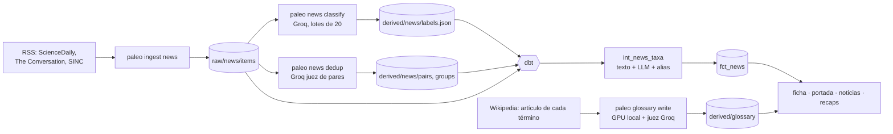

# Fase 5 — IA y noticias

> Alcance y casillas: [`ALCANCE.md` §7, Fase 5](../../ALCANCE.md#7-fases-y-entregables), [§5 (F9)](../../ALCANCE.md#5-fuentes-de-datos) y [§12.2](../../ALCANCE.md#12-ia-fichas-narrativas-y-glosario). Este documento explica el porqué.
>
> **Estado (2026-11-08): hecha.** Noticias y glosario se publicaron el 2026-11-08 (v39). Los últimos arreglos del enlace de noticias a fichas (v41) están en `fase-3`, a la espera de pasar a `main`.

## 1. En una frase

La web lee a diario **tres medios con licencia** (ScienceDaily, The Conversation y SINC). Un LLM clasifica cada noticia y la empareja con la misma noticia en otros medios e idiomas. Cuando la noticia nombra un animal con ficha, aparece en esa ficha. Además, cada término técnico de las fichas tiene una **definición emergente** escrita y comprobada como las propias fichas.

## 2. El problema

Una enciclopedia que se actualiza sola tiene sus fuentes en los estudios y en Wikipedia, pero el lector se entera de las novedades por la prensa. Y la prensa de divulgación tiene tres problemas para una web como esta:

1. **Licencias.** La mayoría de los medios no dejan reutilizar ni el titular. Solo valen los que lo permiten por escrito (F9), y el resumen se guarda tal cual, con su atribución.
2. **Ruido.** De 421 noticias de paleontología y ciencias de la Tierra, 354 no tratan de los grupos del atlas: mamíferos, homínidos, clima, geología.
3. **Repetición.** La misma noticia sale en dos medios y en dos idiomas, y no debe aparecer dos veces.

El glosario tiene su propio problema: las fichas usan unas 160 palabras técnicas («holotipo», «yugal», «*nomen dubium*») y **el usuario no puede revisar a mano cientos de definiciones**, porque no las conoce todas. Una definición inventada por un LLM, en una web que presume de citar cada frase, sería peor que no tenerla.

## 3. Conceptos, desde cero

**Clasificación de texto: baseline frente a LLM.** Un baseline clásico (TF-IDF + regresión logística) aprende de ejemplos etiquetados; un LLM clasifica siguiendo instrucciones, sin entrenamiento. Para comparar los dos hacen falta **etiquetas humanas**, nunca las del propio LLM.

**Sesgo de anclaje.** Si quien etiqueta ve la propuesta del modelo, tiende a aceptarla. Por eso las métricas «con la propuesta a la vista» son una **cota superior**, y la medida honesta es una **muestra a ciegas**: etiquetas hechas sin ver nada.

**Acuerdo de una persona consigo misma.** Si la misma persona, a ciegas, solo coincide con sus primeras etiquetas en el 84 %, ningún clasificador puede medirse por encima de ese techo. Es el ruido de la propia tarea.

**Deduplicación con un juez LLM.** Para saber si dos noticias cuentan lo mismo, la opción clásica es medir la similitud del texto (TF-IDF) y fijar un umbral. Pero entre idiomas casi no comparten palabras. La alternativa es preguntar a un LLM por **cada par candidato** (noticias publicadas con ±5 días de diferencia): «¿es el mismo hallazgo?».

**Enlace de entidades.** Encontrar qué animal nombra una noticia y llevarlo a su ficha. Hay dos caminos, y los dos se comprueban contra la enciclopedia:
- el **texto**: el nombre científico aparece como palabra entera;
- el **LLM**: un nombre que el modelo leyó, que solo vale si tiene ficha y el artículo lo nombra de verdad.

**Generación con fuente y juez.** Una definición del glosario se redacta **a partir del artículo de Wikipedia del término**, citado con su revisión. Se publica solo si pasa comprobaciones deterministas y si un **juez de otra familia de modelos** confirma que todo lo que dice está en la fuente. La persona revisa una muestra y el porcentaje de acierto se publica.

## 4. Cómo funciona aquí

- **Ingesta (F9):** `paleo ingest news` lee los feeds del seed `news_feeds`, que solo tiene medios con condiciones que permiten reutilizar titular y enlace. Guarda titular, enlace, fecha y, donde está permitido, el resumen sin modificar. Corre a diario en `pipeline.yml`, dentro de «Ingest and parse».
- **Clasificación:** `paleo news classify --provider groq` (`openai/gpt-oss-120b`) pone cada noticia en una de cuatro clases publicadas: especie nueva, investigación, revisión taxonómica y ruido. Por dentro distingue «hallazgo» y «estudio» (`category_detail`) y lista los animales que nombra. Solo clasifica las noticias nuevas.
- **Deduplicación:** `paleo news dedup` pregunta a Groq por cada par candidato una sola vez (las respuestas quedan guardadas). `groups.json` agrupa los pares con *union-find*.
- **Enlace a fichas:** [`int_news_taxa`](../../dbt/models/intermediate/int_news_taxa.sql).
  - Por texto: el nombre de la ficha como palabra entera, con mayúscula y de 5 letras o más (*Jian* o *Mei* también son nombres de persona), o un nombre de prensa del seed `taxon_aliases` (megalodón → *Otodus*).
  - Por el LLM: el nombre propuesto vale si es una ficha, o si lo es su género (también un género nuevo con ficha propia), y el artículo lo nombra: su género o la abreviatura «T. rex».
  - Si el LLM confirmó la ficha de la noticia, se descartan las que solo salen por el texto: son animales citados de pasada («primo cercano de *Velociraptor*»).
- **Web:**
  - en la ficha, la tarjeta «En los medios» con las 3 más recientes;
  - en la portada, pestañas «Estudios | En los medios»;
  - «En los medios esta semana» en los resúmenes semanales;
  - la página `es/noticias.html` / `en/news.html`, con filtros y las noticias con ficha destacadas.

  Nunca se publica el ruido.
- **Glosario:**
  - 163 términos elegidos a mano de las fichas verificadas (seed `glossary_terms`);
  - `paleo glossary write --provider ollama --judge-provider groq` redacta con el modelo local y juzga con `qwen/qwen3.8-27b`;
  - comprobaciones: anti-copia de 8 palabras, de 10 a 35 palabras, no circular, cifras (también escritas con letra) y juez;
  - en la web, ventanas emergentes anidadas: al quedarse 1,5 s se bloquean y un término dentro abre otra encima ([`static/glossary.js`](../../site/static/glossary.js)).
- **Medición:** `paleo eval news` compara con `eval/news/labels.csv` (300 titulares), `blind_labels.csv` (50 a ciegas) y `pairs.csv` (47 pares). Las etiquetas se hacen con `scripts/label_news.py`.

## 5. Por qué así

| Decisión | Alternativa | Por qué |
|---|---|---|
| Solo tres medios con licencia | Agregadores o *scraping* | Reutilizar sin permiso no es una opción en un repo público; tres medios dieron 67 noticias publicables entre junio de 2025 y noviembre de 2026 |
| LLM para clasificar | El baseline TF-IDF | Macro F1 0,89 frente a 0,50 con las mismas 300 etiquetas; el baseline no acierta ni una «especie nueva» (13 ejemplos) |
| Cuatro clases publicadas | Las cinco del LLM | «Hallazgo» y «estudio» los intercambian el LLM y la propia persona; con cuatro, 74 % a ciegas frente al 84 % de la persona consigo misma |
| Juez LLM por par | TF-IDF con umbral, o embeddings | F1 1,00 frente a 0,29 en 47 pares, 5 de ellos entre idiomas; 4 llamadas; funciona en Actions sin GPU ni descargas |
| Dos caminos de enlace comprobados | Fiarse del LLM | El LLM propone nombres que el artículo no dice, o que no tienen ficha; el texto solo no encuentra «T. rex» ni los géneros cortos |
| Glosario redactado desde la fuente, con juez y muestra | Borrador del LLM revisado a mano | Revisar cientos de términos no es viable; así cada definición tiene cita y la muestra mide el acierto |
| Términos elegidos a mano | Que los eligiera un LLM | Los LLM probados elegían mal: Qwen 9B inventaba términos y `qwen3.8-27b` en Groq cortaba el JSON (1.000 tokens de salida por minuto) |
| Redactor local + juez en Groq | Todo en Groq | La cuota diaria de Groq se comparte con Actions; la GPU local cuesta 0 € y el juez es de otra familia |

## 6. Cómo se comprueba

- **`tests/test_news*.py`:** lectura de feeds, clasificación por lotes, salida JSON válida, juez de pares, union-find y métricas.
- **dbt:**
  - `int_news_taxa` tiene dos tests unitarios: nombre en el texto y por el LLM (un nombre inventado o sin ficha se descarta), y género nuevo con ficha + alias + mención de pasada;
  - las relaciones con `dim_taxon` comprueban que cada enlace va a una ficha que existe.
- **`tests/test_glossary.py`:** términos, comprobaciones de las definiciones (también las cifras con letra) y marcado en las fichas.
- **Métricas:** [`eval/reports/2026-11-08-news.md`](../../eval/reports/2026-11-08-news.md) (la del 7 es la primera) y las cifras del README.
- **Muestra del glosario:** `scripts/review_glossary.py` enseña 20 definiciones al azar con su fuente. Resultado: 19 correctas y 1 que el usuario no supo juzgar.
- **En el navegador:** ficha, portada, noticias y glosario en ES/EN, escritorio y 390 px, sin errores de consola. Además, todos los enlaces de la página de noticias resuelven a un archivo del build.

## 7. Resultados reales (2026-11-08)

| | |
|---|---|
| Noticias | 421 (del 2025-06-05 al 2026-11-06): SINC 237, ScienceDaily 86, The Conversation 73 EN + 25 ES |
| Clases | 354 ruido, 58 investigación, 9 especie nueva |
| Con ficha | 20 de las 67 publicables, 22 enlaces a 13 fichas: 15 por los dos caminos, 6 solo por el LLM, 1 solo por el texto (la única es ruido y no se publica) |
| Clasificación (300 con la propuesta a la vista) | macro F1 0,89 del LLM frente a 0,50 del baseline (cota superior: 294 de 300 etiquetas mantuvieron la propuesta) |
| Clasificación (50 a ciegas) | 74 % del LLM; 84 % de la persona consigo misma |
| Enlace (a ciegas, 8 nombres visibles) | precisión 0,54, recall 0,88, F1 0,67 (antes de la v41: 0,50 / 0,75 / 0,60) |
| Deduplicación (47 pares) | juez Groq F1 1,00; TF-IDF 0,29 |
| Glosario | 163 términos; 144 definiciones verificadas en EN y 139 en ES; 26 rechazadas tras dos intentos, 9 términos sin artículo fuente |
| Muestra del glosario | 19 de 20 correctas (95 %), 1 sin juzgar |

La precisión del enlace está **subestimada**. Los 6 «falsos positivos» de la muestra a ciegas son 4 noticias de *T. rex* y 1 de megalodón en las que la persona no tecleó el animal, y una errata al teclear («Purussarus»). Revisados uno a uno, los 22 enlaces publicados van a la ficha correcta, salvo *Oviraptor* en la noticia del nido, que se refiere a los oviraptóridos en general.

## 8. Qué salió mal y qué se aprendió

- **El etiquetado con la propuesta a la vista no mide nada independiente.** 294 de 300 etiquetas coincidían con el LLM. En vez de publicar un 98 %, se hizo una muestra a ciegas de 50 y se publican las dos cifras, cada una con su significado. *Lección: decide cómo vas a etiquetar antes de enseñar la propuesta del modelo.*
- **La tarea tiene su propio techo.** La persona, a ciegas, cambió de opinión en 8 de 50. Fusionar las dos clases que se confundían («hallazgo» y «estudio») subió el acuerdo del LLM y el de la persona. *Lección: si los humanos no coinciden, la clase está mal definida, no el modelo.*
- **Una noticia destacada llevaba a la ficha equivocada.** La del dinosaurio de cuatro alas (*Jian changmaensis*) enlazaba a *Velociraptor*, que solo salía como «primo cercano». *Jian* tenía ficha, pero el camino del texto ignora los nombres cortos y el del LLM solo buscaba el género en fichas de tipo `genus`, no en las de géneros nuevos. Arreglado en la v41: el LLM también llega a los géneros nuevos, se descartan las menciones de pasada y hay un seed de alias (las dos noticias del megalodón no enlazaban a *Otodus*). *Lección: revisar a mano todas las salidas cuando son pocas (aquí 20) encuentra lo que las métricas agregadas no ven.*
- **Los LLM eligen mal los términos de un glosario.** Qwen 9B se inventaba términos y el modelo grande de Groq no cabía en su límite de salida. Se eligieron a mano 163 términos en una tarde: es trabajo de una vez.
- **Las cifras escritas con letra se escapaban** («fifty-eight million»). La comprobación de cifras del glosario las lee desde la v39.
- **La cuota diaria de Groq se agota.** La pasada del español del glosario se cortó un día, y las llamadas hechas quedaron en caché. Un 400 `json_validate_failed` de Groq paraba la ejecución entera; ahora cuenta como salida inválida y el lote sigue.
- **Fusionar datos de dos ramas que clasifican lo mismo.** Actions y la rama de trabajo clasificaban las mismas noticias, y `labels.json` chocaba. `scripts/merge_data.py` las une por clave y rehace los grupos.

## 9. Preguntas de entrevista

- **¿Por qué un LLM y no un clasificador entrenado?** Con 300 ejemplos y una clase de 13, el baseline no aprende «especie nueva» (F1 0,00). El LLM sigue una definición y cuesta 0 € dentro de la cuota gratuita. El baseline sigue en el informe como referencia.
- **¿Cómo sabes que tus métricas no están infladas?** Porque digo cuáles lo están. Las 300 etiquetas con propuesta son una cota superior, y la cifra que publico es la de 50 a ciegas junto al techo humano.
- **¿Por qué un juez LLM para duplicados, si es más caro que TF-IDF?** Entre idiomas TF-IDF no ve la relación (F1 0,29). El juez se llama solo con los pares candidatos (±5 días, de paleontología) y una vez por par: 4 llamadas en el conjunto de 47 pares.
- **¿Cómo evitas que el LLM enlace un animal que la noticia no nombra?** Cada nombre propuesto tiene que tener ficha y aparecer en el texto, como género o como «T. rex». Lo que solo encuentra el texto cuenta como mención de pasada si el LLM ya identificó al protagonista.
- **¿Cómo publicas definiciones generadas sin revisarlas todas?** Cada una sale de una fuente citada y pasa comprobaciones deterministas y un juez de otra familia de modelos. Una muestra al azar revisada a mano da el acierto que se publica: 19 de 20.

## 10. Límites y lo que queda

- **Muestras pequeñas.** El enlace a ciegas se mide con 8 nombres y el glosario con 20 definiciones. Las cifras se publican con su tamaño de muestra.
- **Solo se ve el titular y el resumen.** El artículo completo no se guarda (licencias), así que un animal que solo sale en el cuerpo de la noticia no se enlaza: de 21 nombres escritos a ciegas, solo 8 estaban a la vista del sistema.
- **«Revisión» no se mide.** No hay ninguna noticia de revisión taxonómica en la muestra.
- **El prompt no se ha mejorado a propósito.** Sus errores en «especie nueva» se medirían en una sesión a ciegas con ~50 noticias nuevas dentro de unas semanas, no afinando sobre las mismas.
- **Alias a mano.** El seed `taxon_aliases` solo tiene el megalodón. Otros nombres de prensa se añaden cuando aparezcan.
- **El glosario no se rehace solo.** Si cambian las fuentes o aparecen términos nuevos en las fichas, hay que volver a lanzarlo a mano.
