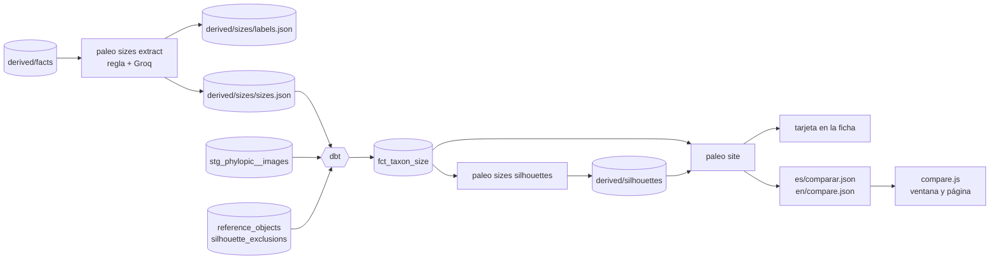

# Fase 6 — Comparador de tamaños

> Alcance y casillas: [`ALCANCE.md` §7, Fase 6](../../ALCANCE.md#7-fases-y-entregables) y [§11.3](../../ALCANCE.md#11-la-web-idiomas-páginas-y-ficha). Este documento explica el porqué.
>
> **Estado (2026-11-08): hecha y publicada** (`main` `76b75480`, `data` `b1b45266`, ejecución del pipeline 42486287744). Los modelos 3D, que también eran de esta fase, pasaron al backlog en la v40.

## 1. En una frase

Cada ficha con un tamaño con fuente lleva una tarjeta con el animal **a escala frente a una persona**. Al pulsarla se abre un comparador donde ponerlo junto a otros animales del atlas, personas, animales actuales y edificios, y **arrastrar las siluetas** para superponerlas. Las cifras salen solo de frases ya verificadas de la ficha.

## 2. El problema

Un lector entiende «13 metros» mucho peor que «como un autobús» o que ver al *T. rex* al lado de una persona. Las webs de comparación que hay sueltan una cifra redonda sin fuente, y para los animales extintos eso es engañoso: el tamaño es una estimación, cambia con los estudios y a veces sale de cuatro huesos.

Tres restricciones:

1. **Ninguna cifra inventada** (§19): solo se publica un tamaño que diga una fuente, con su cita.
2. **0 €**: nada de pagar por un conjunto de datos ni por un modelo grande sin límites.
3. **No romper la lectura de la ficha**: el comparador es una tarjeta en la columna lateral, no una sección más.

Antes de escribir nada, maquetas con datos reales (A «vista a escala», B «la cifra», C «escena»). El usuario eligió la **tarjeta de A** y la **ventana de C**: el panel de A crecía hacia abajo al añadir elementos, la tira horizontal de C no. También pidió que el arrastre fuese preciso: agarrar una silueta por su dibujo, no por su rectángulo.

## 3. Conceptos, desde cero

**Extracción de información con una regla y un LLM.** Las fichas ya tienen hechos verificados: frases cortas en inglés comprobadas contra una cita literal de Wikipedia. De ellas hay que sacar «la longitud de un adulto», y ahí está la trampa: hay cráneos, fémures, dientes, juveniles, envergaduras, pies sin convertir, rangos y «hasta». Se reparte el trabajo:
- una **regla determinista** acepta solo la forma más clara («*Taxón* medía/alcanzaba… N m de largo», sin partes del cuerpo, juveniles ni palabras de duda);
- un **LLM** (Groq, `openai/gpt-oss-120b`) etiqueta el resto: «¿longitud del cuerpo entero de un adulto?, mínimo, máximo». Sus números solo valen si están en la frase.

**Estimación principal por la mediana.** Un taxón tiene a menudo varias estimaciones que no coinciden (*Dunkleosteus*: de 3 a 10 m). La que se dibuja es la más cercana a la mediana de las **actuales**. Las que la frase marca como antiguas («early», «originally», «historical») se listan pero no mandan, y las que la propia frase pone en duda («not supported», «exaggerated») no se publican.

**Escala.** Todo se dibuja en metros. Los píxeles por metro se eligen para que quepa lo más grande, y la cuadrícula salta de 0,05 a 100 m para que haya una línea cada 46 px como mínimo.

**Proporción de una silueta.** La longitud de un animal sale de un hecho; su altura no la mide nadie: sale del ancho y el alto de la silueta (altura = longitud × alto/ancho) y se dice así, «altura aproximada según la silueta». Las personas y los objetos son al revés: se conoce su altura y es la anchura la que sale de la proporción.

**Máscara CSS.** Para pintar una silueta de cualquier color y semitransparente, el SVG no se pone como imagen: se usa de **máscara** (`mask-image`) sobre un `div` con color de fondo.

**CORS.** Un navegador solo deja usar una imagen de otro dominio como máscara, o leer sus píxeles en un `canvas`, si ese dominio responde con `Access-Control-Allow-Origin`.

**Hit-testing por el canal alfa.** Para saber qué silueta hay bajo el dedo, cada una se pinta una vez en un `canvas` pequeño (256 px) y se guarda su transparencia. Al pulsar, se recorren de la de arriba a la de abajo y gana la primera **con tinta en ese punto**, con unos 3 px de tolerancia para colas y patas finas. Las diminutas se agarran por su rectángulo más 8 px.

**Pointer events y umbral de arrastre.** Ratón, dedo y lápiz son el mismo evento (`pointerdown/move/up`). Si el puntero se mueve menos de 8 px, es un clic (abre los detalles); si se mueve más, es un arrastre.

## 4. Cómo funciona aquí

- **Extracción:** [`src/paleo/sizes.py`](../../src/paleo/sizes.py) y el prompt [`size_label.md`](../../src/paleo/narrative/prompts/size_label.md). Solo pregunta al LLM por las frases nuevas o cambiadas: cada etiqueta guarda el hash de la frase y la versión del prompt. Se usa `paleo sizes extract [--provider groq] [--no-llm]`.
- **dbt:**
  - `stg_sizes__taxa` lee `sizes.json`;
  - `int_silhouette_best_per_taxon` elige la primera silueta PhyloPic con licencia permitida subiendo por **toda** la clasificación de PBDB (taxón → género → cada clado → grupo) y saca la proporción del nombre del ráster (`/raster/1536x497.png`). Desde la v42, cada nodo ofrece varias imágenes (`stg_phylopic__node_images`, la principal primero) y se toma la primera permitida; los pterosaurios no se dibujan;
  - `fct_taxon_size` lo junta todo;
  - tests: tamaños sensatos (> 0, mín. ≤ máx., ≤ 60 m), licencias permitidas y relación con `dim_taxon`.
- **Seeds:** `reference_objects` (cada medida con su fuente: NCD-RisC o un artículo de Wikipedia con su `oldid`) y `silhouette_exclusions` (42 poses que no sirven para medir, revisadas a ojo).
- **Siluetas:** `paleo sizes silhouettes` descarga cada silueta una sola vez y se queda **solo con el dibujo**: elementos `svg/g/path…` y atributos de dibujo; nada de scripts, enlaces, estilos ni `DOCTYPE` con entidades. La web las sirve en `static/sil/`.
- **Web:**
  - [`site/compare.py`](../../src/paleo/site/compare.py): cifras, frase ES/EN e índice JSON;
  - [`site/static/compare.js`](../../site/static/compare.js): núcleo puro probado con node, más la tarjeta, la ventana (`<dialog>` con `::backdrop` difuminado) y la página;
  - plantillas `taxon.html.j2` y `compare.html.j2`.
- **Pipeline:** `paleo sizes extract --provider groq` va después de los hechos y `paleo sizes silhouettes` después de dbt (si falla, la ejecución sigue). Los dos pasos están también en el DAG de Airflow, porque un test exige la paridad. `merge_data.py` une las etiquetas por clave.

## 5. Por qué así

| Decisión | Alternativa | Por qué |
|---|---|---|
| Tamaños sacados de los hechos verificados | Un seed curado a mano o conjuntos de Dryad (F12) | Los hechos ya están citados y comprobados, y cubren 429 taxones sin trabajo manual; los conjuntos publicados quedan para contrastar (backlog) |
| Regla estricta + LLM solo para las dudosas | Todo con el LLM | ~150.000 tokens en total frente a casi el doble; y lo claro no depende de un modelo |
| Números del LLM comprobados contra la frase | Fiarse de su respuesta | El LLM decide *qué* número es, no lo inventa |
| Mediana de las actuales | Rango total o la primera cifra | El rango total mezcla un documental o un récord de 1991 con el consenso; la mediana resiste un valor extremo |
| Siluetas servidas por la web | Enlazarlas a PhyloPic | Su servidor de imágenes no envía CORS a los navegadores: la máscara no se pinta y no se pueden leer los píxeles |
| Siluetas buscadas por toda la clasificación | Los niveles de la imagen de la ficha (familia, orden) | A *Argentinosaurus* le tocaba la de Saurischia, que es un terópodo |
| Arrastre por el alfa | Por el rectángulo | Petición del usuario: con el rectángulo no se puede coger una silueta que está debajo de otra |
| Un solo componente para ventana y página | Dos | La página es la ventana a página completa; menos código y el mismo comportamiento |

## 6. Cómo se comprueba

- **`tests/test_sizes.py`:** la regla (rangos, pies, números con letra, conversiones duplicadas, cráneos, juveniles, frases donde el animal no es el sujeto); los números del LLM tienen que estar en la frase; la estimación principal; nada de lo que la frase pone en duda; la limpieza de SVG (fuera `script`, `onclick`, `ENTITY` y `foreignObject`).
- **`tests/test_compare.py`:** cifras y frases en los dos idiomas, y que el índice solo lleve lo que se puede dibujar.
- **`tests/test_compare_js.py`:** el núcleo de `compare.js` corre con node: escala, encaje, cuadrícula, umbral de 8 px, «la de arriba solo se agarra donde tiene tinta» y el estado en la URL.
- **dbt:** `assert_sizes_are_sane`, `assert_drawn_silhouettes_have_allowed_license`, unicidad y relaciones.
- **Muestra a mano:** `scripts/review_sizes.py` (127.0.0.1:8773) enseña 20 tamaños con su frase y la cita literal: 10 leídos por la regla y 10 por el LLM. Resultado: **19 correctas y 1 «no lo sé»** (*Ichthyosaurus*: un rango que junta varias especies). Respuestas en `eval/sizes/review.csv`.
- **En el navegador:** ES/EN, escritorio y 390 px (en un iframe, porque la ventana del usuario es ultrapanorámica), sin errores de consola ni desborde horizontal, en local y en la web publicada.

## 7. Resultados reales (2026-11-08)

| | |
|---|---|
| Frases con una longitud | 2.868 en 610 taxones con hechos |
| Aceptadas | 1.182: 440 por la regla y el resto por el LLM, que etiquetó ~1.190 frases dudosas |
| Taxones con tamaño | 429 (416 dibujables en la web publicada; tras el arreglo de la v42, 417, y 190 con la silueta del propio animal o su género en vez de 71) |
| Coste del LLM | ~150.000 tokens de gpt-oss en un día (de 200.000 gratuitos); luego solo frases nuevas |
| Siluetas | 177 archivos limpios (1,5 MB); 42 poses excluidas |
| Índice del comparador | ~286 KB sin comprimir por idioma, cargado solo al abrir la ventana |
| Muestra revisada | 19 correctas, 1 sin decidir, de 20 |
| Tests | 291 de pytest, 189 de dbt |

## 8. Qué salió mal y qué se aprendió

- **La primera regla aceptaba de todo.** Daba por «longitud del animal» los anillos traqueales de *Scipionyx* (0,33 mm), las branquispinas de *Leedsichthys* o los húmeros de *Eurotrochilus*. Una lista negra de partes del cuerpo nunca está completa. Se le dio la vuelta: **lista blanca de la forma clara** y todo lo demás al LLM. *Lección: en extracción, mejor una regla estrecha y precisa que una amplia con excepciones.*
- **Los extremos delatan los errores.** Ordenar por tamaño y mirar los 10 primeros y los 10 últimos encontró en minutos lo que una muestra aleatoria habría tardado en ver: 0 m, 1 mm, el récord de *Maraapunisaurus* (58 m, una estimación histórica) o los 50 m de *Supersaurus*. Ese último era un empate entre dos estimaciones que se resolvía por el número del hecho; ahora desempata la mediana de todas.
- **«Tiene CORS» no es «funciona en el navegador».** `curl` con `Origin` devolvía la cabecera, pero Chrome rechazaba la petición, también desde la web publicada. Se descubrió en el build real, no en las maquetas, que servían las siluetas desde el mismo origen. *Lección: probar en el navegador con el origen de producción, no con `curl`.*
- **La silueta de la ficha no vale para medir.** La búsqueda saltaba de la familia al orden, y en la primera pasada a ojo de 197 siluetas salieron 31 inútiles: vistas desde arriba, aves posadas, pterosaurios en vuelo, cuerpos en diagonal. Al excluirlas aparecieron otras 10 malas. Se repitió hasta que no salió ninguna.
- **El *Giganotosaurus* llevaba la silueta de un *Monolophosaurus*** (v42, visto por el usuario en la web publicada; también *Gigantoraptor* con la de *Microvenator* y *Utahraptor*). No era el LLM. Había dos fallos en la ingesta de PhyloPic:
  - en PhyloPic un género monotípico es el segundo nombre del nodo de su especie, y la ingesta solo comparaba el primero, así que el género salía «no encontrado» y el modelo subía hasta Tetanurae;
  - solo se guardaba la imagen principal del nodo, que a veces es no comercial cuando hay otras CC0 o CC BY del mismo animal.

  Ahora se aceptan esos segundos nombres (solo si el primero es una especie de ese género: comparar todos los nombres casó el clado de cocodrilos Loricata con los quitones) y se guardan hasta 12 imágenes por nodo. Las de nivel taxón o género pasan de 71 a 190. La revisión a ojo, en tres vueltas, excluyó 50 poses más: cada pose excluida deja paso a la siguiente, que también hay que mirar. Los pterosaurios de PhyloPic están casi todos en vuelo, así que salen del dibujo hasta que se use la envergadura. *Lección: cuando un dato «no existe» en una fuente, comprobar a mano un caso famoso antes de fiarse de la cobertura.*
- **Y el caso famoso falló otra vez** (v44): el *T. rex* se dibujaba con la silueta de «Tyrannosaurus magnus», la imagen principal que PhyloPic pone al género. Al guardar varias imágenes por nodo se elegía la primera sin mirar de qué especie era, y la revisión a ojo solo cubría las siluetas que cambiaban, no las que ya estaban mal. Ahora se prefiere la propia especie (o las válidas del género según PBDB) y en los niveles de taxón y género solo vale el mismo género. Se midió con una consulta (siluetas cuyo nodo no es la ficha ni una de sus especies): de 10 a 4, todas defendibles. *Lección: una revisión de «lo que cambia» no encuentra lo que ya estaba mal; hace falta además una comprobación que mire todo.*
- **Pequeños tropiezos de herramienta:**
  - Chrome cacheaba el CSS de las maquetas (de ahí el servidor con `no-store`);
  - el servidor local apuntaba a una carpeta del build que se reemplaza al reconstruir;
  - `.ci-data` guardaba restos que hacían fallar tests de dbt que en la CI pasan;
  - un `paleo site` de prueba sobrescribió el build real.

  Nada llegó a publicarse mal, pero cada uno costó una vuelta.

## 9. Preguntas de entrevista

- **¿Cómo te aseguras de que el LLM no se inventa cifras?** No las crea: decide cuál de los números que ya están en la frase es la longitud del adulto, y la respuesta se rechaza si su número no aparece en la frase. Además, solo ve frases ya verificadas contra la fuente.
- **¿Cuánto acierta?** En una muestra de 20 revisada a mano, 19 correctas y 1 dudosa, la mitad de la regla y la mitad del LLM. Es una muestra pequeña, y así se publica.
- **¿Por qué no usar solo el LLM?** Por coste (cuota gratuita), reproducibilidad y explicabilidad: la mitad de los tamaños los lee una regla que se puede leer y testear.
- **¿Cómo eliges una cifra cuando las fuentes discrepan?** No elijo una sola: dibujo la más cercana a la mediana de las actuales y enseño el abanico, la cita y si sale de restos parciales.
- **¿Qué es CORS y por qué te afectó?** Es la regla del navegador para leer recursos de otro dominio. Las máscaras CSS y `getImageData` la exigen, y el CDN de PhyloPic no la cumplía para los navegadores, así que el pipeline guarda copias limpias.
- **¿Cómo detectas qué silueta tocas?** Leo el canal alfa de cada una en un canvas y recorro de arriba abajo; la primera con tinta bajo el puntero gana.
- **¿Es seguro servir SVG de terceros?** Un SVG puede llevar scripts. Por eso se reconstruye cada archivo con una lista blanca de elementos y atributos de dibujo, y un test lo comprueba.

## 10. Límites y lo que queda

- **La altura es aproximada** y muchas veces sale de la silueta del grupo, no del propio animal. Se dice en cada caso.
- **6 taxones con tamaño no se dibujan** (v42): los pterosaurios, porque PhyloPic casi solo tiene pterosaurios en vuelo y se miden por la envergadura.
- **Las especies nuevas que PBDB aún no ha clasificado no se dibujan** (6 en la v42): la única silueta posible era la de todo su grupo (Dinosauria es un *Eoraptor*). Se dibujan solas cuando PBDB las clasifica. La ejecución diaria vuelve a consultar PBDB por nombre cada 7 días y el catálogo cada mes; después consulta PhyloPic para sus clados y descarga la silueta. Lo que no es automático es la revisión de las poses: una silueta nueva en mala pose saldría publicada hasta que alguien la añada a `silhouette_exclusions`.
- **La envergadura no se usa**, y es como se mide a los pterosaurios (backlog). Tampoco la masa (backlog).
- **Las referencias son pocas** (8) y la persona promedio es española (NCD-RisC, 19 años); en la página en inglés también.
- **El autobús mide la longitud máxima legal en la UE** (13,5 m), porque es la cifra que da la fuente; un autobús urbano típico es algo más corto.
- **Contrastar con conjuntos publicados** (Dryad, O'Gorman y Hone 2012) queda en el backlog.
- **Las frases de los hechos pueden tener errores propios.** El comparador enseña la cita literal precisamente para eso. (El «T. rex» de *Tylosaurus* no lo era: *Tylosaurus rex* es una especie de 2026. Desde la v41 se escribe en cursiva y enlaza a su ficha, y los hechos que cambian el nombre de una especie se rechazan.)
